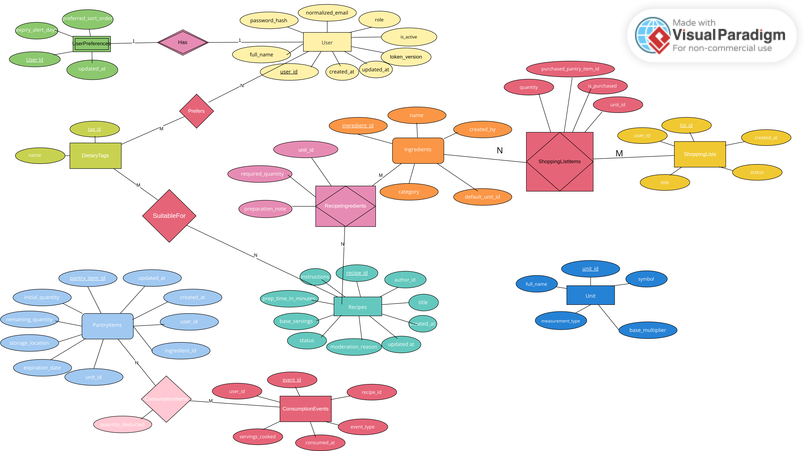

# BBF 302E Database Systems

## ER Diagram and Data Model Design

*Milestone 2 · Fall 2026*

# 1. Team and Project Information

| **Field** | **Details** |
| --- | --- |
| Team name | CHAOS |
| Project topic | Recipe & Smart Pantry Platform |
| Team leader | Can Sei Keçeci |
| Team members (names and student IDs) | Can Sei Keçeci – 150240007  Hamza Çevikbaş – 150240025  Ahmet Abalı – 150240052  Ömer Türk – 150240323  Selim Efe Aytemur – 150230070 |
| GitHub repository URL | https://github.com/kececi24/smart-pantry-platform |

# 2. Entity Identification and Completeness [15 Points]

The Recipe & Smart Pantry Platform connects a member’s pantry lots to recipe search, shopping and consumption history. The model keeps each physical lot separate so that buying an ingredient again does not overwrite the quantity or expiration date of an older lot.

| Entity | Purpose / information represented | Related FR ID(s) |
| --- | --- | --- |
| Users | Registered accounts, unique normalized e-mail addresses, password hashes, access roles and session revocation state. | FR-01–03, FR-19 |
| UserPreferences | One settings record per registered account. It stores the expiry alert window and default recipe sort order. | FR-01, FR-03, FR-06, FR-09–10, FR-19 |
| Units | Reference units, measurement dimensions and conversion multipliers for ingredient quantities. | FR-04–06, FR-08, FR-10, FR-12–16, FR-18 |
| Ingredients | Canonical ingredient names, categories, default units and catalog creator references. | FR-04–06, FR-08–10, FR-12–13, FR-18 |
| PantryItems | Individual food lots with an owner, ingredient, storage location, expiration date and initial and remaining quantities. | FR-05–06, FR-10, FR-13–18 |
| Recipes | Recipe authorship, instructions, serving count, preparation time, publication status and moderation reason. | FR-07–10, FR-13, FR-15, FR-18, FR-20 |
| DietaryTags | Reusable dietary labels, such as Vegan and Nut-Free, used in member preferences and recipe search. | FR-03, FR-09–10 |
| ShoppingLists | Named shopping lists owned by individual users. Each list is open or archived. | FR-11–14 |
| ConsumptionEvents | Cooking and direct-consumption records with an owner, event time and, where applicable, the recipe and servings. | FR-15–19 |
| RecipeIngredients | Associative entity recording an ingredient requirement, unit and optional preparation note for each recipe line. | FR-07–10, FR-13, FR-15 |
| ShoppingListItems | Associative entity recording a planned ingredient amount, purchase status and any pantry lot created at confirmation. | FR-11–14 |
| ConsumptionItems | Relationship with a quantity attribute. Each line records how much one event deducted from a specific pantry lot. | FR-15–18 |
| UserDietaryTags | Junction table for the Prefers relationship. Each row links one user to one dietary label. | FR-03, FR-09–10, FR-19 |
| RecipeDietaryTags | Junction table for the SuitableFor relationship. Each row links one recipe to one dietary label. | FR-07, FR-09–10 |
|  |  |  |

# 3. Relationships and Cardinality Correctness [20 Points]

## 3.1 ER Diagram

Insert a legible ER diagram showing entities, attributes, relationships and cardinalities. Use consistent notation. Show 1:1, 1:N and M:N relationships where applicable.

## 3.2 Relationship Details

*Explain each relationship, its cardinality and any optional/mandatory participation. Include how M:N relationships will be resolved.*

The diagram uses Chen notation. User and Unit map to Users and Units in the relational schema. The relationship table below makes the links represented by reference attributes explicit, including ownership, measurement units and the optional purchase-to-lot link. In each 1:N relationship, the parent may have zero or more children.

| Entity A | Relationship | Entity B | Cardinality | Explanation |
| --- | --- | --- | --- | --- |
| Users | Has | UserPreferences | 1:1 | Exactly one profile per account. Registration creates both together. |
| Users | Owns | PantryItems | 1:N | Every lot requires one owner. |
| Users | Authors | Recipes | 1:N | Every recipe requires one author. |
| Users | Owns | ShoppingLists | 1:N | Every list requires one owner. |
| Users | Records | ConsumptionEvents | 1:N | Every event requires one owner. |
| Users | Creates | Ingredients | 1:N | Creator is optional. Catalog entries survive account deletion. |
| Units | Defines default for | Ingredients | 1:N | Each ingredient requires one default unit. |
| Ingredients | Identifies | PantryItems | 1:N | Every lot requires one ingredient. |
| Units | Measures | PantryItems | 1:N | Every lot requires one compatible unit. |
| Recipes | Requires | Ingredients | M:N | RecipeIngredients links each pair. Published recipes need at least one line. Drafts and ingredients may have none. |
| Units | Measures | RecipeIngredients | 1:N | Every recipe line requires one compatible unit. |
| ShoppingLists | Contains | Ingredients | M:N | ShoppingListItems links each pair. Lists and ingredients can have zero or more lines. |
| Units | Measures | ShoppingListItems | 1:N | Every shopping line requires one compatible unit. |
| ShoppingListItems | Creates on confirmation | PantryItems | 0..1 : 0..1 | A confirmed line links to one lot. Either side can exist without a link. |
| Recipes | Is used in | ConsumptionEvents | 1:N | One recipe per new cooking event. Direct events and cooking events whose recipe was deleted have no reference. |
| ConsumptionEvents | Deducts from | PantryItems | M:N | ConsumptionItems records each deduction. Events need at least one line. Lots may have none. |
| Users | Prefers | DietaryTags | M:N | UserDietaryTags links each pair. Both sides are optional. |
| Recipes | SuitableFor | DietaryTags | M:N | RecipeDietaryTags links each pair. Both sides are optional. |
|  |  |  |  |  |

# 4. Data Requirements [10 Points]

| Data Req. ID | Data requirement / information needed | Related FR ID(s) | Relevant entities |
| --- | --- | --- | --- |
| DR-01 | Store each account’s normalized e-mail, name, password hash, role, active state and token version. Initialize its preference record in the registration transaction. | FR-01–02 | Users, UserPreferences |
| DR-02 | Maintain the user’s alert window, recipe sort order and selected dietary tags. Support resetting these settings and clearing tag assignments. | FR-03, FR-06, FR-09–10, FR-19 | UserPreferences, UserDietaryTags, DietaryTags |
| DR-03 | Maintain searchable ingredient names and categories, each ingredient’s default unit, and the dimension and conversion factor of every supported unit. | FR-04–06, FR-08, FR-12 | Ingredients, Units |
| DR-04 | Track separate lots for each purchase or manual addition. Record the owner, ingredient, quantities, unit, storage location and known or unknown expiration date. | FR-05–06, FR-10, FR-13–17 | PantryItems, Ingredients, Units |
| DR-05 | Store recipe titles, instructions, serving yields, preparation times and publication status. Record moderation reasons when administrators unpublish a recipe. | FR-07, FR-09, FR-20 | Recipes |
| DR-06 | Maintain ingredient requirements per recipe and base serving yield. Store preparation notes and assign dietary tags for compatibility filters. | FR-07–10, FR-13, FR-15 | Recipes, RecipeIngredients, Ingredients, Units, RecipeDietaryTags, DietaryTags |
| DR-07 | Read usable pantry totals by ingredient for the current user, scale recipe lines to the requested servings and compute any shortage. | FR-06, FR-10, FR-13 | PantryItems, Recipes, RecipeIngredients, Units, UserPreferences |
| DR-08 | Maintain named shopping lists, archive status and one quantity per ingredient. Track the purchase flag and the pantry lot created by confirmation. | FR-11–14 | ShoppingLists, ShoppingListItems, Ingredients, Units, PantryItems |
| DR-09 | Record each event’s time, owner and type, with a recipe and serving count for new cooking events. Record the exact amounts deducted from each lot. | FR-15–17 | ConsumptionEvents, ConsumptionItems, PantryItems, Recipes |
| DR-10 | Retrieve event counts, ingredient totals in canonical units and recipe cooking frequencies over a selected month. | FR-18 | ConsumptionEvents, ConsumptionItems, PantryItems, Ingredients, Units, Recipes |
| DR-11 | Identify owned records for account deletion and keep catalog entries and other members’ cooking histories consistent after removal. | FR-19 | Users, UserPreferences, UserDietaryTags, Ingredients, Recipes, ShoppingLists, PantryItems, ConsumptionEvents |

# 5. ER-to-Relational Schema Mapping, Table Planning and Database Complexity [20 Points]

The design retains the ten core tables proposed in Milestone 1 and adds Units, DietaryTags, UserDietaryTags and RecipeDietaryTags. Unit symbols and conversion factors are defined once. Dietary tags are stored as individual assignments, so a recipe or account can have several tags without a list-valued column. Composite keys identify individual assignments and ingredient lines.

| ER component / relationship | Resulting table(s) | Mapping explanation / design decision |
| --- | --- | --- |
| Independent entities | Users, Units, Ingredients, PantryItems, Recipes, DietaryTags, ShoppingLists, ConsumptionEvents | Use a surrogate primary key for each entity. Apply unique constraints to normalized e-mail addresses and reusable lookup names or symbols. |
| Has (identifying 1:1) | Users, UserPreferences | UserPreferences.user_id is both the primary key and a foreign key to Users. The registration transaction ensures a profile exists for every account. |
| Ownership and authorship (1:N) | Users, PantryItems, Recipes, ShoppingLists, ConsumptionEvents | Put the required user_id on each owned lot, list and event, and author_id on each recipe. All reference Users. |
| Catalog creator and recipe history (1:N) | Users, Ingredients, Recipes, ConsumptionEvents | Set Ingredients.created_by and ConsumptionEvents.recipe_id to NULL when their referenced parent is deleted. Event type and serving count preserve the distinction between cooking and direct consumption. |
| Ingredient and unit references (1:N) | Ingredients, Units, PantryItems, RecipeIngredients, ShoppingListItems | PantryItems references its ingredient. Ingredients.default_unit_id and the three line or lot unit_id fields reference Units. The application checks that their dimensions agree. |
| Recipes require ingredients (M:N) | Recipes, RecipeIngredients, Ingredients | Use (recipe_id, ingredient_id) as the primary key and both columns as foreign keys. Each row also has required_quantity, unit_id and an optional preparation_note. |
| Lists contain ingredients (M:N) | ShoppingLists, ShoppingListItems, Ingredients | Use (list_id, ingredient_id) as the primary key and both columns as foreign keys. The same row holds the quantity, unit and purchase state. |
| Purchase produces a lot (optional 1:1) | ShoppingListItems, PantryItems | Place the nullable, unique purchased_pantry_item_id on ShoppingListItems. The purchase transaction locks the line and writes the lot and its link together. |
| Events draw from lots (M:N) | ConsumptionEvents, ConsumptionItems, PantryItems | Use (event_id, pantry_item_id) as the primary key. The junction stores quantity_deducted in the lot’s unit to support exact stock restoration. |
| Prefers and SuitableFor (M:N) | Users, Recipes, DietaryTags, UserDietaryTags, RecipeDietaryTags | Use (user_id, tag_id) and (recipe_id, tag_id) as composite keys. Each column references its parent. Store a label name once in DietaryTags. |

## 5.1 Planned Table Overview

| # | Table name | Purpose | Related table(s) | Responsible member |
| --- | --- | --- | --- | --- |
| 1 | Users | Accounts and authentication state. | UserPreferences, Ingredients, PantryItems, Recipes, ShoppingLists, ConsumptionEvents, UserDietaryTags | Can Sei Keçeci |
| 2 | UserPreferences | Personal expiry and recipe sorting defaults. | Users | Can Sei Keçeci |
| 3 | Units | Measurement dimensions and conversion multipliers. | Ingredients, PantryItems, RecipeIngredients, ShoppingListItems | Hamza Çevikbaş |
| 4 | Ingredients | Canonical entries used by inventory, recipes and shopping. | Users, Units, PantryItems, RecipeIngredients, ShoppingListItems | Hamza Çevikbaş |
| 5 | PantryItems | Physical food lots and their current balances. | Users, Ingredients, Units, ShoppingListItems, ConsumptionItems | Hamza Çevikbaş |
| 6 | Recipes | Recipe content, publication state and moderation feedback. | Users, RecipeIngredients, RecipeDietaryTags, ConsumptionEvents | Ahmet Abalı |
| 7 | DietaryTags | Reusable dietary labels. | UserDietaryTags, RecipeDietaryTags | Ahmet Abalı |
| 8 | ShoppingLists | Named open and archived lists. | Users, ShoppingListItems | Ömer Türk |
| 9 | ConsumptionEvents | Headers for cooking and direct-consumption history. | Users, Recipes, ConsumptionItems | Selim Efe Aytemur |
| 10 | RecipeIngredients | Ingredient requirements for a recipe’s base servings. | Recipes, Ingredients, Units | Ahmet Abalı |
| 11 | ShoppingListItems | Ingredient quantities, purchase flags and confirmed lot links. | ShoppingLists, Ingredients, Units, PantryItems | Ömer Türk |
| 12 | ConsumptionItems | Per-lot quantities deducted by an event. | ConsumptionEvents, PantryItems | Selim Efe Aytemur |
| 13 | UserDietaryTags | Dietary tags selected by individual users. | Users, DietaryTags | Can Sei Keçeci |
| 14 | RecipeDietaryTags | Dietary tags assigned to individual recipes. | Recipes, DietaryTags | Ahmet Abalı |

# 6. Attributes, Keys, and Data Types [20 Points]

## Table 1: Users

**Purpose: **Accounts and authentication state.**    Responsible member: **Can Sei Keçeci

| Column | SQL data type | PK / FK (reference) | Nullability / Uniqueness / Other Constraints |
| --- | --- | --- | --- |
| user_id | INT UNSIGNED | PK | NOT NULL, AUTO_INCREMENT |
| full_name | VARCHAR(120) | — | NOT NULL, nonblank |
| normalized_email | VARCHAR(254) | — | NOT NULL, UNIQUE, utf8mb4_bin collation |
| password_hash | VARCHAR(255) | — | NOT NULL, Argon2id encoded hash |
| role | ENUM('member', 'admin') | — | NOT NULL, DEFAULT 'member' |
| is_active | TINYINT UNSIGNED | — | NOT NULL, DEFAULT 1, CHECK IN (0, 1) |
| token_version | INT UNSIGNED | — | NOT NULL, DEFAULT 0 |
| created_at | DATETIME(6) | — | NOT NULL, current timestamp on insert |
| updated_at | DATETIME(6) | — | NOT NULL, current timestamp on insert and update |

## Table 2: UserPreferences

**Purpose: **Personal expiry and recipe sorting defaults.**    Responsible member: **Can Sei Keçeci

| Column | SQL data type | PK / FK (reference) | Nullability / Uniqueness / Other Constraints |
| --- | --- | --- | --- |
| user_id | INT UNSIGNED | PK, FK → Users(user_id) | NOT NULL, ON DELETE CASCADE |
| expiry_alert_days | SMALLINT UNSIGNED | — | NOT NULL, DEFAULT 7, CHECK 0 to 365 |
| preferred_sort_order | ENUM('expiry', 'title', 'prep_time') | — | NOT NULL, DEFAULT 'expiry' |
| updated_at | DATETIME(6) | — | NOT NULL, current timestamp on insert and update |

## Table 3: Units

**Purpose: **Measurement dimensions and conversion multipliers.**    Responsible member: **Hamza Çevikbaş

| Column | SQL data type | PK / FK (reference) | Nullability / Uniqueness / Other Constraints |
| --- | --- | --- | --- |
| unit_id | INT UNSIGNED | PK | NOT NULL, AUTO_INCREMENT |
| symbol | VARCHAR(12) | — | NOT NULL, UNIQUE |
| full_name | VARCHAR(60) | — | NOT NULL, UNIQUE |
| measurement_type | ENUM('mass', 'volume', 'count') | — | NOT NULL |
| base_multiplier | DECIMAL(12,6) | — | NOT NULL, CHECK > 0 |

## Table 4: Ingredients

**Purpose: **Canonical entries used by inventory, recipes and shopping.**    Responsible member: **Hamza Çevikbaş

| Column | SQL data type | PK / FK (reference) | Nullability / Uniqueness / Other Constraints |
| --- | --- | --- | --- |
| ingredient_id | INT UNSIGNED | PK | NOT NULL, AUTO_INCREMENT |
| name | VARCHAR(120) | — | NOT NULL, UNIQUE, nonblank |
| category | VARCHAR(60) | — | NOT NULL, nonblank |
| default_unit_id | INT UNSIGNED | FK → Units(unit_id) | NOT NULL |
| created_by | INT UNSIGNED | FK → Users(user_id) | NULL, ON DELETE SET NULL |

## Table 5: PantryItems

**Purpose: **Physical food lots and their current balances.**    Responsible member: **Hamza Çevikbaş

| Column | SQL data type | PK / FK (reference) | Nullability / Uniqueness / Other Constraints |
| --- | --- | --- | --- |
| pantry_item_id | INT UNSIGNED | PK | NOT NULL, AUTO_INCREMENT |
| user_id | INT UNSIGNED | FK → Users(user_id) | NOT NULL |
| ingredient_id | INT UNSIGNED | FK → Ingredients(ingredient_id) | NOT NULL |
| unit_id | INT UNSIGNED | FK → Units(unit_id) | NOT NULL |
| initial_quantity | DECIMAL(14,6) | — | NOT NULL, CHECK > 0 |
| remaining_quantity | DECIMAL(14,6) | — | NOT NULL, CHECK 0 ≤ remaining_quantity ≤ initial_quantity |
| storage_location | VARCHAR(60) | — | NOT NULL, nonblank |
| expiration_date | DATE | — | NULL if the date is unknown |
| created_at | DATETIME(6) | — | NOT NULL, current timestamp on insert |
| updated_at | DATETIME(6) | — | NOT NULL, current timestamp on insert and update |

## Table 6: Recipes

**Purpose: **Recipe content, publication state and moderation feedback.**    Responsible member: **Ahmet Abalı

| Column | SQL data type | PK / FK (reference) | Nullability / Uniqueness / Other Constraints |
| --- | --- | --- | --- |
| recipe_id | INT UNSIGNED | PK | NOT NULL, AUTO_INCREMENT |
| author_id | INT UNSIGNED | FK → Users(user_id) | NOT NULL |
| title | VARCHAR(160) | — | NOT NULL, nonblank |
| instructions | TEXT | — | NULL in a draft, required for publication |
| base_servings | SMALLINT UNSIGNED | — | NOT NULL, CHECK > 0 |
| prep_time_in_minutes | SMALLINT UNSIGNED | — | NULL if unknown, CHECK > 0 when entered |
| status | ENUM('draft', 'published') | — | NOT NULL, DEFAULT 'draft' |
| moderation_reason | VARCHAR(500) | — | NULL unless a moderation reason is recorded |
| created_at | DATETIME(6) | — | NOT NULL, current timestamp on insert |
| updated_at | DATETIME(6) | — | NOT NULL, current timestamp on insert and update |

## Table 7: DietaryTags

**Purpose: **Reusable dietary labels.**    Responsible member: **Ahmet Abalı

| Column | SQL data type | PK / FK (reference) | Nullability / Uniqueness / Other Constraints |
| --- | --- | --- | --- |
| tag_id | INT UNSIGNED | PK | NOT NULL, AUTO_INCREMENT |
| name | VARCHAR(80) | — | NOT NULL, UNIQUE, nonblank |

## Table 8: ShoppingLists

**Purpose: **Named open and archived lists.**    Responsible member: **Ömer Türk

| Column | SQL data type | PK / FK (reference) | Nullability / Uniqueness / Other Constraints |
| --- | --- | --- | --- |
| list_id | INT UNSIGNED | PK | NOT NULL, AUTO_INCREMENT |
| user_id | INT UNSIGNED | FK → Users(user_id) | NOT NULL |
| title | VARCHAR(120) | — | NOT NULL, nonblank |
| status | ENUM('open', 'archived') | — | NOT NULL, DEFAULT 'open' |
| created_at | DATETIME(6) | — | NOT NULL, current timestamp on insert |

## Table 9: ConsumptionEvents

**Purpose: **Headers for cooking and direct-consumption history.**    Responsible member: **Selim Efe Aytemur

| Column | SQL data type | PK / FK (reference) | Nullability / Uniqueness / Other Constraints |
| --- | --- | --- | --- |
| event_id | INT UNSIGNED | PK | NOT NULL, AUTO_INCREMENT |
| user_id | INT UNSIGNED | FK → Users(user_id) | NOT NULL |
| recipe_id | INT UNSIGNED | FK → Recipes(recipe_id) | NULL, ON DELETE SET NULL |
| event_type | ENUM('cooking', 'direct') | — | NOT NULL |
| servings_cooked | SMALLINT UNSIGNED | — | NULL for direct events. Required and positive for cooking. |
| consumed_at | DATETIME(6) | — | NOT NULL, current timestamp on insert |

## Table 10: RecipeIngredients

**Purpose: **Ingredient requirements for a recipe’s base servings.**    Responsible member: **Ahmet Abalı

| Column | SQL data type | PK / FK (reference) | Nullability / Uniqueness / Other Constraints |
| --- | --- | --- | --- |
| recipe_id | INT UNSIGNED | PK, FK → Recipes(recipe_id) | NOT NULL, ON DELETE CASCADE |
| ingredient_id | INT UNSIGNED | PK, FK → Ingredients(ingredient_id) | NOT NULL |
| unit_id | INT UNSIGNED | FK → Units(unit_id) | NOT NULL |
| required_quantity | DECIMAL(14,6) | — | NOT NULL, CHECK > 0 |
| preparation_note | VARCHAR(255) | — | NULL |

## Table 11: ShoppingListItems

**Purpose: **Ingredient quantities, purchase flags and confirmed lot links.**    Responsible member: **Ömer Türk

| Column | SQL data type | PK / FK (reference) | Nullability / Uniqueness / Other Constraints |
| --- | --- | --- | --- |
| list_id | INT UNSIGNED | PK, FK → ShoppingLists(list_id) | NOT NULL, ON DELETE CASCADE |
| ingredient_id | INT UNSIGNED | PK, FK → Ingredients(ingredient_id) | NOT NULL |
| unit_id | INT UNSIGNED | FK → Units(unit_id) | NOT NULL |
| quantity | DECIMAL(14,6) | — | NOT NULL, CHECK > 0 |
| is_purchased | TINYINT UNSIGNED | — | NOT NULL, DEFAULT 0, CHECK IN (0, 1) |
| purchased_pantry_item_id | INT UNSIGNED | FK → PantryItems(pantry_item_id) | NULL, UNIQUE |

## Table 12: ConsumptionItems

**Purpose: **Per-lot quantities deducted by an event.**    Responsible member: **Selim Efe Aytemur

| Column | SQL data type | PK / FK (reference) | Nullability / Uniqueness / Other Constraints |
| --- | --- | --- | --- |
| event_id | INT UNSIGNED | PK, FK → ConsumptionEvents(event_id) | NOT NULL, ON DELETE CASCADE |
| pantry_item_id | INT UNSIGNED | PK, FK → PantryItems(pantry_item_id) | NOT NULL |
| quantity_deducted | DECIMAL(14,6) | — | NOT NULL, CHECK > 0 |

## Table 13: UserDietaryTags

**Purpose: **Dietary tags selected by individual users.**    Responsible member: **Can Sei Keçeci

| Column | SQL data type | PK / FK (reference) | Nullability / Uniqueness / Other Constraints |
| --- | --- | --- | --- |
| user_id | INT UNSIGNED | PK, FK → Users(user_id) | NOT NULL, ON DELETE CASCADE |
| tag_id | INT UNSIGNED | PK, FK → DietaryTags(tag_id) | NOT NULL |

## Table 14: RecipeDietaryTags

**Purpose: **Dietary tags assigned to individual recipes.**    Responsible member: **Ahmet Abalı

| Column | SQL data type | PK / FK (reference) | Nullability / Uniqueness / Other Constraints |
| --- | --- | --- | --- |
| recipe_id | INT UNSIGNED | PK, FK → Recipes(recipe_id) | NOT NULL, ON DELETE CASCADE |
| tag_id | INT UNSIGNED | PK, FK → DietaryTags(tag_id) | NOT NULL |

Guest access is unauthenticated. The Users table stores member and administrator accounts. MySQL enforces primary, foreign and unique keys and row-level checks. Foreign keys use RESTRICT on deletion unless a table specifies a different action. Timestamp defaults and automatic updates use CURRENT_TIMESTAMP(6). The Flask service validates nonblank input and dates and checks rules that span tables, such as unit compatibility, ownership and publication prerequisites. Quantities use decimal arithmetic. Convert through the dimension’s base unit and round only when storing a value at the target precision.

Pantry lot balances must remain between zero and the initial quantity, and manual adjustments must leave enough capacity to restore all recorded deductions. Lot ingredient and unit remain fixed once the lot has a deduction or a linked purchase. Unit dimensions and multipliers remain stable once referenced. An expiration date before the application’s current date excludes a lot from usable stock. A lot with an unknown date can contribute stock without generating an expiry alert. FIFO uses creation time and lot ID.

Marking an item purchased and confirming its delivery into the pantry are separate states. A marked line can be unconfirmed. A confirmed line has a purchase flag of 1 and a lot link for the same owner and ingredient. The confirmation transaction locks the list and line, checks the existing link and creates at most one lot.

Every new cooking event has a recipe and a positive serving count. A direct event has neither and draws from lots for a single ingredient. A cooking event keeps its serving count and lot deductions if its recipe is deleted. Locking and updating event rows and affected lots in a consistent order allows corrections, reversals and new deductions to commit together or roll back together.

Planned indexes cover owner and expiration date on PantryItems, owner and ingredient on PantryItems, recipe status and preparation time on Recipes, and owner and event date on ConsumptionEvents. Reverse indexes on tag assignments support filtering by tag. EXPLAIN will be used to assess query plans against the larger fixtures.

# 7. Data Population Planning [5 Points]

The project will use a fixed-seed Python generator, original ingredient lists and fictional recipe data. Counts below describe the functional dataset. It uses a fixed reference date so tests can reproduce expiry and monthly reporting results.

| Table / entity | Source or generation method | Estimated rows | Relationship / realism considerations |
| --- | --- | --- | --- |
| Users | Fixed-seed Python generator. Generate fictional names, e-mails and test-only credentials. | 102 | 100 members and 2 admins. Normalize e-mails and hash fixture passwords. Include a few disabled accounts. |
| UserPreferences | Create a profile for each seeded account. | 102 | Use the production registration defaults, then vary alert windows and sort orders. |
| Units | Seed a curated unit dictionary. | 5 | Use g and kg for mass, ml and l for volume, and pcs for count. Base units are g, ml and pcs. |
| Ingredients | Curate an original grocery ingredient list. | 120 | Give each ingredient a valid default unit and category. Leave creator references blank for imports or assign a seeded admin. |
| PantryItems | Generate lots for fictional households and process seeded purchases and deductions. | 3,000 | Include multiple lots for the same ingredient, several locations, and fresh, expiring, expired and unknown dates. |
| Recipes | Seed original fictional recipes and parameterize titles, timings and servings. | 200 | Use existing authors and include drafts, published entries and moderated drafts. |
| DietaryTags | Seed a small fixed list of dietary labels. | 8 | Apply labels to recipes only where consistent with the curated ingredient combinations. |
| ShoppingLists | Generate grocery lists for member accounts. | 180 | Use plausible titles and a mix of open and archived lists. |
| ConsumptionEvents | Generate events within a fixed reporting period. | 600 | Use both cooking and direct events and distribute them across several calendar months. |
| RecipeIngredients | Generate lines from plausible recipe and ingredient combinations. | 1,600 | Use compatible units and unique recipe/ingredient pairs. Published recipes have instructions and at least one line. |
| ShoppingListItems | Generate manual and recipe-shortage items. | 1,200 | Use one row per ingredient and list. Seed pending items, marked items and confirmed purchases with distinct lot links. |
| ConsumptionItems | Run the same lot-allocation routine used for live consumption. | 1,800 | Choose valid lots owned by the event owner and deduct positive quantities. Include events that draw from more than one lot. |
| UserDietaryTags | Assign tags to a reproducible subset of members. | 80 | Include members with no preferences, one tag or several tags. |
| RecipeDietaryTags | Assign tags according to the seeded recipe contents. | 260 | Include untagged recipes and recipes that satisfy several tags. |

Seed lookups and accounts first, then recipes, pantry lots, shopping lists and their lines. Use the application’s validation and transaction logic to produce confirmed purchases and consumption history. Separate benchmark fixtures will contain 100,000 pantry lots and 50,000 recipe ingredient lines. The 95th-percentile response time targets are under 500 ms for pantry queries and under one second for paginated recipe matching. Small deterministic fixtures will cover expiry boundaries, unknown dates, unit conversion, tag matching, repeated purchase confirmation and failed or concurrent deductions.

# 8. CRUD Operation Planning [5 Points]

| Operation / scenario | C / R / U / D | User role | Affected tables | Related FR ID(s) | Database Interaction / Description |
| --- | --- | --- | --- | --- | --- |
| Register an account | C, R | Guest | Users, UserPreferences | FR-01 | Normalize the e-mail and insert the account and default profile in one transaction. Report duplicate e-mails through the unique constraint. |
| Manage authentication and account access | R, U | Guest, Member, Admin | Users | FR-02 | Verify the Argon2id hash and account status at sign-in. Check the token version on protected requests. Increment it on logout, password change or access changes. Restrict role and status changes to admins. |
| Read, edit or reset preferences | C, R, U, D | Member | UserPreferences, UserDietaryTags, DietaryTags | FR-03, FR-19 | Read the authenticated user’s settings and tags. Commit the scalar settings and tag changes together. A reset restores defaults and clears tag assignments. |
| Browse and maintain the catalog | C, R, U, D | Guest, Member, Admin | Ingredients, Units | FR-04 | Allow public catalog reads. Admins maintain entries after checking their units. Restrictive foreign keys prevent deletion of referenced ingredients. |
| Manage pantry lots | C, R, U, D | Member | PantryItems, Ingredients, Units, UserPreferences, ConsumptionItems, ShoppingListItems | FR-05–06 | Scope all operations to the owner and validate dates, units and balances. Delete only empty, unreferenced lots. Read current, expiring and expired stock by ingredient or location. |
| Edit, tag and publish recipes | C, R, U, D | Member | Recipes, RecipeIngredients, RecipeDietaryTags, Ingredients, Units, DietaryTags | FR-07–08, FR-20 | Update owned recipes and their lines and tags. Check instructions and at least one line before publishing. Allow draft deletion and resubmission after moderation. |
| Search and match recipes | R | Guest, Member | Recipes, RecipeIngredients, Ingredients, Units, RecipeDietaryTags, UserDietaryTags, UserPreferences, PantryItems | FR-08–10 | Apply visibility before filtering or scaling. Members can compare visible recipe requirements against their own pantry and dietary settings. |
| Moderate a published recipe | R, U | Admin | Recipes | FR-20 | Change its status to draft and save the moderation reason in one update. The owner can review the reason and resubmit. |
| Manage shopping lists and items | C, R, U, D | Member | ShoppingLists, ShoppingListItems, Ingredients, Units | FR-11–12 | Scope lists to their owner. Edit item quantities and pending purchase flags on open lists. Archive, reopen or delete lists. Deleting a list removes its lines and retains its confirmed pantry lots. |
| Merge recipe shortages | C, R, U | Member | Recipes, RecipeIngredients, PantryItems, Units, ShoppingLists, ShoppingListItems | FR-13 | Compute shortages for the requested servings. Lock the open list and merge compatible quantities into unpurchased rows. Report conflicts with purchased rows or use a new list. |
| Confirm a shopping purchase | C, R, U | Member | ShoppingLists, ShoppingListItems, PantryItems, Ingredients, Units | FR-14 | Lock the owned list and item. Return the existing lot link on retry. Otherwise insert the lot, set the purchase flag and save the link in the same transaction. |
| Record cooking or direct consumption | C, R, U | Member | Recipes, RecipeIngredients, PantryItems, Units, ConsumptionEvents, ConsumptionItems | FR-15–16 | Lock eligible owned lots in a consistent order. Recheck stock, allocate deductions in first-in, first-out order and commit the lot balances and event lines together. |
| Read, correct or delete an event | C, R, U, D | Member | ConsumptionEvents, ConsumptionItems, PantryItems | FR-17 | Filter history by owner and date. Lock the event and affected lots, restore old deductions, then replace the event lines or remove the event in the same transaction. |
| Read monthly consumption summary | R | Member | ConsumptionEvents, ConsumptionItems, PantryItems, Ingredients, Units, Recipes | FR-18 | Filter by owner and month. Aggregate lot deductions by ingredient and count cooking events independently of their detail rows. |
| Delete an account | R, D | Member | Users and owned records | FR-19 | After identity verification, remove owned event details and shopping lines before lots, and remove owned recipes and preferences in the same transaction. Clear optional foreign keys to owned recipes and catalog creator IDs. |

# 9. Complex Query Planning [5 Points]

| Query ID / purpose | Related FR ID(s) | Tables involved | Planned techniques / expected result |
| --- | --- | --- | --- |
| Q-01  Pantry totals and expiry alerts | FR-05–06 | PantryItems, Ingredients, Units, UserPreferences | Filter owned lots by location or ingredient. Join unit conversions, classify remaining stock by date and use conditional SUM and MIN with GROUP BY to return totals by ingredient and the earliest known expiry. |
| Q-02  Visible recipes that meet dietary preferences | FR-03, FR-09 | Recipes, RecipeDietaryTags, DietaryTags, UserDietaryTags, UserPreferences | Filter to published recipes and the member’s own drafts. Apply title and preparation-time filters. Use nested NOT EXISTS to require every selected tag. Return paginated results using an allowed sort order. |
| Q-03  Pantry match and expiry ranking | FR-06, FR-08, FR-10 | Recipes, RecipeIngredients, PantryItems, Ingredients, Units, UserPreferences, UserDietaryTags, RecipeDietaryTags | Use CTEs to apply visibility and dietary filters, scale lines and aggregate valid stock in base units. LEFT JOIN required lines to stock totals and compute shortages. Rank full matches first and use FIFO window totals to estimate how many lines draw on soon-expiring lots. |
| Q-04  Missing items for selected servings | FR-08, FR-10, FR-13 | Recipes, RecipeIngredients, PantryItems, Ingredients, Units, ShoppingListItems | LEFT JOIN each scaled requirement to usable stock. Treat missing stock as zero, keep positive shortages with GREATEST and convert back to the ingredient’s default unit. Compare with existing list lines before merging. |
| Q-05  FIFO lot allocation for an event | FR-15–17 | PantryItems, Ingredients, Units, ConsumptionItems | Read valid owned lots and compute a running total per ingredient with SUM OVER ordered by creation time and lot ID. Cap the final lot at the unmet quantity. For writes, use balances rechecked under row locks. |
| Q-06  Monthly ingredients and most-cooked recipes | FR-17–18 | ConsumptionEvents, ConsumptionItems, PantryItems, Ingredients, Units, Recipes | Filter the event headers to the member and a half-open month range. Sum converted deductions by ingredient and default unit separately from event counts. GROUP BY recipe_id and rank referenced recipes by cook count. |

# 10. Additional Design Information

## 10.1 Relational DBMS Selection

**Selected DBMS: **MySQL with InnoDB

**Brief justification: **MySQL provides foreign keys, unique and quantity constraints, transactions, row locks and the CTEs and window functions used by the query plan. The Flask application will connect through mysqlclient and execute handwritten, parameterized SQL. Numbered SQL migrations and a fixed-seed generator will be versioned with the project.

## 10.2 Milestone 1 Scope Changes

The application scope remains the same as in Milestone 1. It covers personal pantry management, a shared recipe catalog, rule-based matching, shopping and consumption history. The logical design now specifies 14 tables because measurement units and dietary labels need reusable reference records, and multiple tag assignments need two junction tables.

The design also specifies how the application preserves purchase and consumption records. Confirming a shopping line links it to a single pantry lot. Consumption records retain exact per-lot deductions so that stock can be restored during a correction or deletion. These changes make the behavior described in FR-14 and FR-17 explicit in the relational schema.

# 11. Pre-Submission Checklist

☒ All required entities are identified and justified.

☒ ER diagram is readable and relationships/cardinalities are correct.

☒ Data requirements are linked to Milestone 1 functional requirements.

☒ ER-to-relational mapping is explained and includes at least 10 related tables.

☒ Every table has complete columns, types, keys and constraints.

☒ Realistic data population is planned.

☒ CRUD operations and complex query scenarios are described.

☒ Relational DBMS is selected (not SQLite); no ORM will be used.

☒ Significant changes from Milestone 1 are explained.

☒ All guidance and example placeholders have been replaced.

# Important: Mandatory TA Meeting

All members must attend the TA project meeting during November 30–December 4, 2026. Failure to attend results in a 50% deduction from the overall project grade, not only the Milestone 2 grade.
