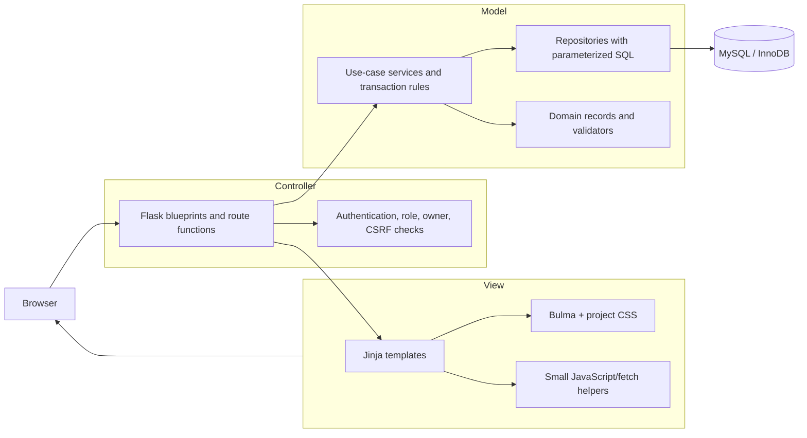
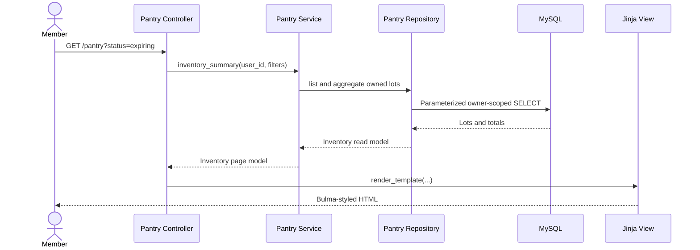
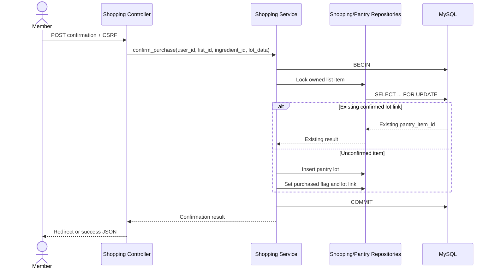
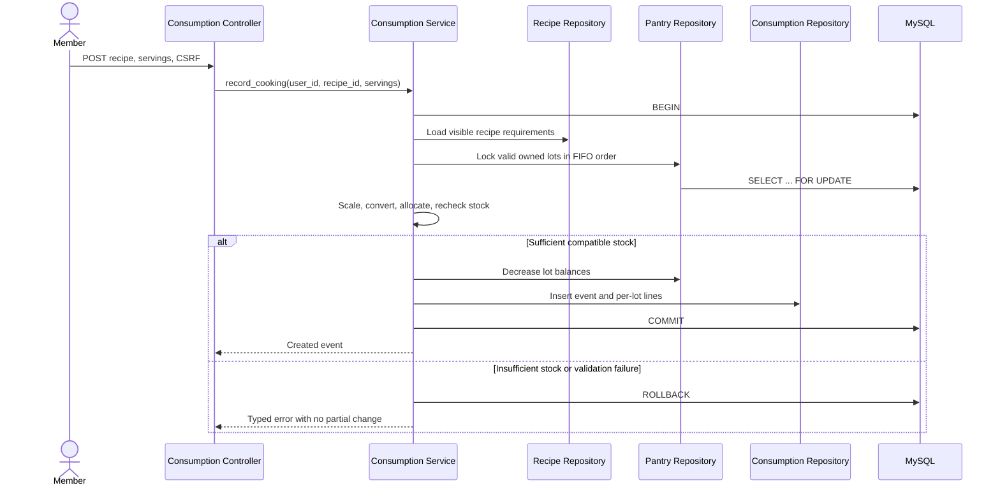

# Recipe and Smart Pantry Platform — MVC Architectural Design

> **Document purpose:** This document defines the code-level Model–View–Controller (MVC) architecture for the Recipe and Smart Pantry Platform. It is an implementation contract, not a directory-tree proposal. It adapts the working pattern demonstrated by the Database Recitation Project—Flask routes, Python model/database code, Jinja templates, a shared layout, custom CSS, and Bulma components—to this project's MySQL-backed requirements.

## Cover Page

| Field | Details |
| --- | --- |
| **Course** | BBF 302E Database Systems |
| **Project** | Recipe and Smart Pantry Platform |
| **Team** | CHAOS |
| **Document** | MVC Architectural Design |
| **Architecture** | Server-rendered MVC with service and repository boundaries |
| **Backend** | Python, Flask, mysqlclient, handwritten parameterized SQL |
| **Frontend** | Jinja HTML templates, Bulma CSS, project CSS, small JavaScript/fetch enhancements |
| **Database** | MySQL with InnoDB |
| **Document version** | 1.0 |

---

## Change Log

| Version | Date | Author(s) | Sections affected | Description |
| --- | --- | --- | --- | --- |
| 1.0 | 2026-11-22 | Team CHAOS | All | Initial MVC architecture based on the approved requirements, project plan, data model, and recitation example. |

---

## 1. Purpose and Scope

This architecture supports the workflows in `FR-01` through `FR-20`: accounts and preferences, ingredient administration, pantry lots, recipes and matching, shopping and purchase confirmation, consumption, reporting, and moderation. It also provides the separation needed to verify `NFR-01` through `NFR-10`, especially owner-scoped authorization, parameterized SQL, responsive UI behavior, transaction integrity, performance measurement, and maintainability.

The application is a Flask web application whose primary responses are server-rendered HTML. JavaScript and `fetch` may improve interactions such as serving recalculation or shopping-item updates, but the same controller and service rules remain authoritative on the server.

The following constraints are binding:

- MySQL/InnoDB is the authoritative store.
- All SQL is handwritten and parameterized through `mysqlclient`; no ORM is used.
- Every private read and mutation is scoped to the authenticated user.
- Multi-table purchase and consumption operations use explicit transactions and row locks.
- Jinja templates produce semantic HTML and use Bulma for the shared responsive design system.
- Project CSS customizes branding and behavior that Bulma does not provide.
- Business and database rules do not live in templates.

## 2. Architectural Style

### 2.1 MVC Responsibilities

| Layer | Responsibility | May depend on | Must not do |
| --- | --- | --- | --- |
| **Model** | Represent domain values; validate business rules; execute owner-scoped queries; coordinate transactional use cases. | Database connection, repositories, domain services | Render HTML, inspect Jinja state, or choose HTTP redirects. |
| **View** | Present data through Jinja templates, Bulma components, project CSS, and accessible HTML. | View models supplied by controllers | Execute SQL, decode tokens, decide ownership, or mutate domain state. |
| **Controller** | Map URLs and HTTP methods to use cases; read input; invoke services; translate results into HTML, redirects, or JSON. | Authentication helpers, services, view rendering | Contain complex SQL, duplicate business rules, or manually construct page HTML. |
| **Infrastructure** | Create the Flask app, load configuration, manage database connections, register blueprints, and provide security/error utilities. | Flask and external libraries | Own feature-specific business decisions. |

The project's “Model” is broader than a single Python data class. Because an ORM is prohibited, it consists of small domain records, repositories containing raw SQL, and services that enforce cross-table rules and transactions.

### 2.2 High-Level Component Diagram



### 2.3 Request Lifecycle

1. The application factory creates and configures the Flask application.
2. A `before_request` security hook loads the signed session token, verifies account state and token version, and exposes the current user to the request.
3. A blueprint controller matches the URL and method.
4. For a mutation, the controller validates the CSRF token and converts form or JSON input into typed command values.
5. The controller calls one service method for the use case.
6. The service validates business rules and calls repositories. Transactional services explicitly begin, commit, or roll back one database transaction.
7. Repositories execute parameterized SQL and map rows to domain records or read models.
8. The controller renders a Jinja template, redirects after a successful mutation, or returns a small JSON response for a fetch request.
9. Error handlers translate known failures into consistent `400`, `401`, `403`, `404`, `409`, or `500` responses.

## 3. Code Layout by Responsibility

This section defines code ownership and callable interfaces rather than prescribing a folder tree.

### 3.1 Application and Infrastructure Code

| Code unit | Primary callable(s) | Responsibility |
| --- | --- | --- |
| Application factory | `create_app(config_object=None)` | Create Flask, load environment-backed settings, initialize extensions, register blueprints and error handlers. |
| Database lifecycle | `get_db()`, `close_db()`, `transaction()` | Acquire one pooled MySQL connection per request, release it safely, and provide commit/rollback boundaries. |
| Authentication helpers | `load_current_user()`, `login_required`, `role_required()` | Validate JWT cookie, expiry, `is_active`, `token_version`, and required role. |
| CSRF helper | `generate_csrf_token()`, `validate_csrf()` | Protect every state-changing form and fetch request. |
| Error mapping | `register_error_handlers(app)` | Render stable error pages or JSON error objects without exposing SQL or secrets. |
| Configuration | Development, test, and production configuration objects | Keep secrets and connection values outside source control; disable debug in deployment. |

The factory follows the recitation project's `create_app()` pattern, but registers feature blueprints instead of placing every URL rule in one function. It must not seed production data during startup.

### 3.2 Model Code: Domain Records

Domain records are lightweight Python `dataclass` objects or immutable mappings. They describe application data without database behavior.

| Domain record | Important fields | Related database table(s) |
| --- | --- | --- |
| `User` | `user_id`, `full_name`, `normalized_email`, `role`, `is_active`, `token_version` | `Users` |
| `UserPreference` | `user_id`, `expiry_alert_days`, `preferred_sort_order`, selected tags | `UserPreferences`, `UserDietaryTags` |
| `Unit` | `unit_id`, `symbol`, `measurement_type`, `base_multiplier` | `Units` |
| `Ingredient` | `ingredient_id`, `name`, `category`, `default_unit_id` | `Ingredients` |
| `PantryLot` | Owner, ingredient, unit, initial/remaining quantities, location, expiry | `PantryItems` |
| `Recipe` | Author, title, instructions, servings, prep time, status, moderation reason | `Recipes` |
| `RecipeLine` | Recipe, ingredient, unit, quantity, preparation note | `RecipeIngredients` |
| `ShoppingList` / `ShoppingItem` | Owner, status, ingredient, quantity, purchase and confirmation state | `ShoppingLists`, `ShoppingListItems` |
| `ConsumptionEvent` / `ConsumptionLine` | Owner, type, recipe/servings, time, per-lot deductions | `ConsumptionEvents`, `ConsumptionItems` |
| `DietaryTag` | `tag_id`, `name` | `DietaryTags`, `RecipeDietaryTags` |

Quantities use `Decimal`, never binary floating point. Dates and timestamps use Python date/time objects. Domain constructors reject impossible local values such as nonpositive quantities, but repositories and database constraints remain the final integrity boundary.

### 3.3 Model Code: Repositories

Each repository owns SQL for one entity or cohesive aggregate. Repository methods receive a connection explicitly when they participate in a service transaction.

| Repository | Representative methods | Required behavior |
| --- | --- | --- |
| `UserRepository` | `create_with_preferences`, `find_by_email`, `get_active_by_id`, `update_password`, `set_status` | Normalize lookup values, never return password hashes to views, support atomic registration. |
| `PreferenceRepository` | `get_for_user`, `update_for_user`, `replace_tags`, `reset_for_user` | Scope all writes to `user_id`; update scalar settings and tags together. |
| `IngredientRepository` | `search`, `get`, `create`, `update`, `delete_unreferenced` | Public reads; admin-only writes enforced by controller/service; parameterized filters. |
| `PantryRepository` | `list_for_user`, `get_owned`, `create_lot`, `update_owned`, `delete_empty_unreferenced`, `lock_usable_lots` | Include owner filters in SQL and lock FIFO candidates during deductions. |
| `RecipeRepository` | `search_visible`, `get_visible`, `get_owned`, `save_draft`, `replace_lines`, `publish`, `moderate` | Enforce published/owned visibility and unique ingredient lines. |
| `MatchingRepository` | `find_matches`, `calculate_shortages` | Use CTEs/aggregation for compatible units, serving scaling, expiry exclusion, and pagination. |
| `ShoppingRepository` | `list_for_user`, `get_owned`, `upsert_item`, `lock_item`, `set_confirmed_lot` | Lock an owned open list/item before merging or confirming. |
| `ConsumptionRepository` | `insert_event`, `insert_lines`, `lock_event`, `history_for_user`, `monthly_summary` | Preserve per-lot deductions and keep history owner-scoped. |

Every external value is passed through the database driver's placeholder mechanism. Dynamic sort columns and directions are selected from fixed allowlists and are never copied directly from a request into SQL.

### 3.4 Model Code: Services

Services define use cases and are the only location for workflows spanning several repositories or tables.

| Service | Representative operations | Requirements |
| --- | --- | --- |
| `AccountService` | `register`, `authenticate`, `change_password`, `delete_account` | FR-01–03, FR-19; NFR-01–02 |
| `PantryService` | `add_lot`, `edit_lot`, `inventory_summary` | FR-04–06; NFR-03–04 |
| `RecipeService` | `save_recipe`, `publish`, `search`, `match_pantry`, `moderate` | FR-07–10, FR-20; NFR-05, NFR-07 |
| `ShoppingService` | `save_list`, `merge_shortages`, `confirm_purchase` | FR-11–14; NFR-08 |
| `ConsumptionService` | `record_cooking`, `record_direct`, `correct_event`, `delete_event`, `monthly_report` | FR-15–18; NFR-09 |

Service methods return domain results or raise typed application exceptions such as `ValidationError`, `AuthenticationError`, `AuthorizationError`, `NotFoundError`, `ConflictError`, or `InsufficientStockError`. They do not return Flask response objects.

## 4. Controller Design

### 4.1 Blueprint Boundaries

| Blueprint | URL prefix | Controller responsibility | Related requirements |
| --- | --- | --- | --- |
| `main` | `/` | Landing page, dashboard navigation, shared error pages | Cross-module |
| `auth` | `/auth` | Register, login, logout, account maintenance | FR-01–03, FR-19 |
| `ingredients` | `/ingredients` | Public catalog search and admin maintenance | FR-04 |
| `pantry` | `/pantry` | Pantry lot CRUD, filters, and inventory states | FR-05–06 |
| `recipes` | `/recipes` | Recipe CRUD, publication, search, serving scaling, and matching | FR-07–10, FR-20 |
| `shopping` | `/shopping-lists` | List/item CRUD, shortage merge, purchase confirmation | FR-11–14 |
| `consumption` | `/consumption` | Cooking, direct use, history, corrections, monthly report | FR-15–18 |
| `admin` | `/admin` | Account status, roles, ingredient maintenance, moderation | FR-02, FR-04, FR-20 |

### 4.2 Route and Action Matrix

The final endpoint names may be refined, but controllers must preserve these resource-oriented behaviors.

| Method and path | Controller action | Success response | Access |
| --- | --- | --- | --- |
| `GET /` | Show public landing page or member dashboard | HTML | Guest/Member/Admin |
| `GET, POST /auth/register` | Show form / register account and defaults | HTML / redirect | Guest |
| `GET, POST /auth/login` | Show form / issue signed cookie | HTML / redirect | Guest |
| `POST /auth/logout` | Invalidate session and clear cookie | Redirect | Member/Admin |
| `GET /pantry` | Filter and display owned lots and totals | HTML | Member |
| `GET, POST /pantry/new` | Show form / create a lot | HTML / redirect | Member |
| `GET, POST /pantry/<int:id>/edit` | Show form / update owned lot | HTML / redirect | Owner |
| `POST /pantry/<int:id>/delete` | Delete allowed owned lot | Redirect | Owner |
| `GET /recipes` | Search visible recipes | HTML | All roles |
| `GET /recipes/<int:id>` | Display visible recipe and scaled lines | HTML | Visibility rule |
| `GET, POST /recipes/new` | Show form / create owned draft | HTML / redirect | Member |
| `GET, POST /recipes/<int:id>/edit` | Show form / update owned draft | HTML / redirect | Owner |
| `POST /recipes/<int:id>/publish` | Validate and publish owned recipe | Redirect | Owner |
| `GET /recipes/matches` | Display pantry match results | HTML | Member |
| `POST /recipes/<int:id>/shortages` | Merge shortage lines into a list | Redirect or JSON | Member |
| `GET, POST /shopping-lists` | Display lists / create list | HTML / redirect | Member |
| `GET /shopping-lists/<int:id>` | Display owned list and items | HTML | Owner |
| `POST /shopping-lists/<int:id>/items` | Add or merge an item | Redirect or JSON | Owner |
| `POST /shopping-lists/<int:id>/items/<int:ingredient_id>/confirm` | Confirm purchase exactly once | Redirect or JSON | Owner |
| `POST /consumption/cook` | Record recipe cooking atomically | Redirect or JSON | Member |
| `POST /consumption/direct` | Record direct consumption atomically | Redirect or JSON | Member |
| `GET /consumption/history` | Show owner-filtered history | HTML | Member |
| `GET, POST /consumption/<int:id>/edit` | Show correction form / replace deductions | HTML / redirect | Owner |
| `POST /consumption/<int:id>/delete` | Restore stock and remove event | Redirect | Owner |
| `GET /consumption/monthly` | Show monthly aggregates | HTML | Member |

Successful form mutations follow Post/Redirect/Get. A controller rendering an invalid form returns `400` with the submitted safe values and field errors. Delete, publish, confirmation, logout, and other mutations never use `GET`.

### 4.3 Controller Pattern

```python
@pantry_bp.route("/new", methods=["GET", "POST"])
@login_required
def create_lot():
    if request.method == "GET":
        return render_template("pantry/form.html", form=empty_pantry_form())

    command = PantryLotCommand.from_form(request.form)
    validate_csrf(request.form.get("csrf_token"))
    pantry_service.add_lot(current_user.user_id, command)
    flash("Pantry item added.", "success")
    return redirect(url_for("pantry.index"))
```

This pattern mirrors the recitation controllers while moving database access and business rules into services. The controller stays readable and testable.

## 5. View Design

### 5.1 Shared Jinja Layout

All pages extend one base layout comparable to the recitation project's `layout.html`. It owns:

- HTML metadata, viewport settings, page title blocks, and accessibility defaults.
- A pinned Bulma stylesheet followed by the project's stylesheet so project rules can override library defaults.
- A responsive navbar whose links depend on authentication and role.
- A flash-message region using Bulma notification styles.
- A main content block, optional page-script block, and shared footer.
- A responsive navbar burger controlled by a minimal script.

Recommended blocks are `title`, `head`, `content`, and `scripts`. Repeated UI is implemented with Jinja partials/macros for field errors, pagination, recipe cards, pantry status tags, confirmation dialogs, and empty states.

### 5.2 Screen Inventory

| Screen ID | Screen | Principal templates/content | Related requirements |
| --- | --- | --- | --- |
| UI-01 | Landing and member dashboard | Public introduction or expiring-stock/member summary | FR-06, FR-10, FR-18 |
| UI-02 | Register/login/account | Authentication and preference forms | FR-01–03, FR-19 |
| UI-03 | Pantry inventory | Filters, lot table/cards, status tags, add/edit form | FR-05–06 |
| UI-04 | Ingredient catalog | Search results and admin maintenance controls | FR-04 |
| UI-05 | Recipe search and detail | Search filters, cards, ingredient scaling, instructions | FR-08–10 |
| UI-06 | Recipe editor | Metadata, ingredient lines, tags, publish controls | FR-07–08, FR-20 |
| UI-07 | Pantry recipe matches | Full/partial match states, shortages, expiry-use ranking | FR-10, FR-13 |
| UI-08 | Shopping lists | List tabs, item rows, purchase and confirmation controls | FR-11–14 |
| UI-09 | Consumption workflow/history | Cook/direct forms, event history, correction controls | FR-15–17 |
| UI-10 | Monthly report/admin | Monthly totals and role-specific maintenance views | FR-18, FR-20 |

### 5.3 Bulma Component Standard

Bulma supplies layout and component classes; project CSS supplies color tokens, spacing adjustments, status variants, and any recipe/pantry-specific presentation. The stylesheet load order is always Bulma first, project CSS second.

| UI purpose | Bulma pattern |
| --- | --- |
| Primary action | `button is-primary` |
| Secondary/navigation action | `button is-link is-light` or ordinary navbar link |
| Save/confirm | `button is-success` when confirmation is the semantic intent |
| Destructive action | `button is-danger`, normally behind an explicit confirmation step |
| Cancel/back | `button is-light` |
| Disabled/submitting | `button is-loading` plus native `disabled` while in progress |
| Compact row action | Add `is-small` without changing the semantic color |
| Form input | `field`, `label`, `control`, `input`, `select`, `textarea`, `help is-danger` |
| Data list | `table is-striped is-hoverable is-fullwidth` inside `table-container` |
| Responsive cards | `columns is-multiline`, `column`, `card` |
| Feedback | `notification is-success/is-warning/is-danger` |
| State label | `tag is-success/is-warning/is-danger/is-light` |

Buttons use real `<button>` elements for form actions and `<a>` only for navigation. Icon-only controls require an accessible name. Color is never the only status indicator: text such as “Expiring,” “Expired,” “Purchased,” or “Shortage” accompanies it.

### 5.4 Responsive and Accessible Behavior

- The interface must remain usable at 360 px and desktop widths as required by `NFR-06`.
- Tables that cannot collapse are placed in `table-container`; primary mobile workflows should prefer cards or stacked fields.
- Every input has a visible label, validation errors are associated with their inputs, and focus returns to the first invalid field.
- Keyboard focus is visible; headings remain hierarchical; form actions have clear names.
- Empty, loading, validation, conflict, authorization, and server-error states are designed for each principal workflow.
- Fetch enhancements announce success or error messages and do not remove the server-rendered fallback.

## 6. Critical Interaction Flows

### 6.1 Display Pantry Inventory



### 6.2 Confirm a Shopping Purchase



The unique confirmed-lot link and locked recheck make retries idempotent, satisfying `FR-14` and `NFR-08`.

### 6.3 Record Cooking



Lot locks use one documented order, such as ingredient ID, creation time, then lot ID, to reduce deadlock risk. The same transaction boundary applies to correction and deletion after restoring previous deductions.

## 7. Database and Transaction Rules

### 7.1 Connection Rules

- Acquire a connection lazily for the current request and always close or return it to the pool during teardown.
- Read-only repository calls do not commit.
- A service owns a transaction from the first locked read through the last related write.
- Repositories never commit independently when called inside a service transaction.
- On every exception, roll back before translating or re-raising the error.
- Log transaction failures with a correlation identifier, never with passwords, JWTs, or full sensitive form bodies.

### 7.2 SQL Rules

- Use `%s` placeholders supported by `mysqlclient` and pass values separately.
- Apply `user_id` in the SQL predicate for owner-scoped `SELECT`, `UPDATE`, and `DELETE`; do not rely only on a preceding Python ownership check.
- Use half-open time ranges for monthly reports.
- Use `Decimal` and the unit's base multiplier for compatible conversion.
- Exclude expired and depleted lots from usable stock. Unknown expiry dates may contribute stock but do not create expiry alerts.
- Paginate potentially large result sets and use fixed allowlists for ordering.
- Preserve the indexes and query strategies documented in Milestone 2, then verify them with `EXPLAIN` and benchmark fixtures.

### 7.3 Transaction Ownership

| Use case | Transaction contents | Lock/check requirement |
| --- | --- | --- |
| Registration | Insert `Users` and default `UserPreferences` | Unique normalized email; both rows commit together. |
| Preference update | Update settings and replace dietary tag rows | Owner scope; complete replacement commits together. |
| Recipe publication | Validate recipe, lines, instructions, tags, then change status | Lock/check owned draft if concurrent editing is possible. |
| Shortage merge | Calculate/validate shortages and merge list rows | Lock owned open list and affected item rows. |
| Purchase confirmation | Insert pantry lot and attach it to purchased item | Lock item, recheck existing link, commit once. |
| Cooking/direct use | Deduct lots and insert event/detail rows | Lock eligible lots consistently; recheck balance. |
| Consumption correction/deletion | Restore old lots and replace/remove event data | Lock event and all affected lots; commit or roll back all effects. |
| Account deletion | Remove dependent owned records in the documented order | Verify identity; no partial deletion. |

## 8. Security Design

### 8.1 Authentication and Session

- Passwords are stored only as Argon2id hashes.
- A signed JWT is stored in an `HttpOnly` cookie with a 30-minute expiration, `SameSite=Lax`, and `Secure` in deployment.
- Protected requests validate signature, expiry, account activity, role, and current `token_version`.
- Logout, password changes, and access changes invalidate earlier tokens as defined by the account service.
- Authentication cookies never contain authorization decisions beyond identifiers and signed claims that are rechecked against the database.

### 8.2 Authorization

- Controllers declare login and role requirements.
- Services enforce ownership and workflow rules.
- Repositories include ownership predicates in private queries.
- Administrator status permits account, ingredient, and moderation duties only; it does not grant access to another member's private pantry, shopping lists, or consumption history.
- Unauthorized resource probing returns `403` or `404` consistently without revealing private existence.

### 8.3 Request and Output Safety

- Every mutation validates CSRF.
- Input is parsed into typed values and validated before a write.
- SQL parameters are never interpolated into query text.
- Jinja autoescaping remains enabled; rich user HTML is not accepted for recipe instructions.
- Uploaded files and external integrations are outside the baseline and should not be added without a separate threat review.
- Secrets come from environment variables or deployment secret storage and never from committed settings.

## 9. Error and Feedback Contract

| Condition | HTTP result | View behavior |
| --- | --- | --- |
| Invalid input | `400` | Re-render form, retain safe input, show field and summary errors. |
| Missing/expired authentication | `401` or login redirect for browser page | Explain that sign-in is required; preserve a safe return path. |
| Wrong role/ownership | `403` or privacy-preserving `404` | Render a neutral access message. |
| Resource absent | `404` | Render shared not-found page. |
| Duplicate/retry/state conflict | `409` or an idempotent existing result | Explain the current state and safe next action. |
| Insufficient stock | `409` | Show missing ingredient quantities; make no mutation. |
| Unexpected failure | `500` | Roll back, log correlation ID, render generic error page. |

User-facing controllers use `flash(message, category)` with categories mapped to Bulma notification styles. Messages are specific enough to guide recovery and never expose database exception text.

## 10. Testing Strategy by MVC Layer

| Test level | Primary scope | Representative evidence |
| --- | --- | --- |
| Domain unit tests | Quantity, date, unit, publication, and allocation rules | Deterministic boundary cases without Flask or MySQL where possible. |
| Repository integration tests | SQL mappings, constraints, ownership predicates, query results | Temporary test database with migrations and rollback/cleanup. |
| Service transaction tests | Atomic registration, purchase, cooking, correction, deletion | Forced-failure and two-request concurrency tests. |
| Controller tests | Methods, status codes, redirects, CSRF, auth/role handling, validation | Flask test client and seeded users. |
| Template/UI checks | Jinja rendering, required controls, accessible labels, responsive states | Rendered pages plus 360 px/desktop review. |
| End-to-end tests | Principal member/admin workflows | Seeded environment covering FR-01–20. |
| Performance tests | Pantry search and recipe matching | Documented fixtures, warm-up, 100 measured requests, p95 and `EXPLAIN`. |

External effects are tested through service boundaries. Transaction tests use the real MySQL behavior because an in-memory substitute cannot prove InnoDB locking, constraints, or concurrent correctness.

## 11. Requirements and Work-Package Traceability

| Architecture area | Requirement IDs | Project task / WBS coverage | Deliverable(s) |
| --- | --- | --- | --- |
| App factory, configuration, DB lifecycle | NFR-10 | T-01, T-02; WBS-1.2, WBS-2.1 | D-02, D-11 |
| Authentication and preferences MVC | FR-01–03, FR-19; NFR-01–02 | T-03; WBS-3.1–WBS-3.4 | D-04 |
| Ingredient and pantry MVC | FR-04–06; NFR-03–04 | T-04; WBS-4.1–WBS-4.4 | D-05 |
| Recipe and matching MVC | FR-07–10, FR-20; NFR-05, NFR-07 | T-05; WBS-5.1–WBS-5.5 | D-06 |
| Shopping and purchase MVC | FR-11–14; NFR-08 | T-06; WBS-6.1–WBS-6.4 | D-07 |
| Consumption and reporting MVC | FR-15–18; NFR-09 | T-07; WBS-7.1–WBS-7.4 | D-08 |
| Jinja, Bulma, CSS, responsive UI | NFR-06 | T-05–T-08; WBS-5.5, WBS-6.4, WBS-7.4, WBS-8.5 | D-09 |
| Cross-layer verification | NFR-01–10 | T-08; WBS-8.1–WBS-8.6 | D-10 |

## 12. Implementation Conventions

1. Keep controller functions short: parse input, call one use case, choose a response.
2. Keep SQL in repositories and transaction boundaries in services.
3. Pass the authenticated `user_id` explicitly into every owner-scoped service operation.
4. Use named domain commands/read models rather than passing unstructured request dictionaries deep into the model.
5. Use endpoint names in `url_for()`; do not hard-code internal URLs in templates.
6. Use Jinja inheritance and macros rather than copying the navbar, messages, or form markup.
7. Use Bulma classes for reusable UI behavior and project CSS for a small, documented visual layer.
8. Keep JavaScript progressive and feature-specific; server-side validation remains mandatory.
9. Add a migration and update the data-model documentation for every schema change.
10. Add tests at the layer where each defect could have been prevented, plus an integration test for critical transactions.

## 13. Architecture Acceptance Checklist

- [ ] `create_app()` can start the application with development, test, and production-safe configuration.
- [ ] Blueprints expose the module boundaries defined in Section 4.
- [ ] Controllers contain no handwritten SQL.
- [ ] Templates contain no business or authorization decisions beyond display choices from supplied context.
- [ ] All private repository queries are owner-scoped.
- [ ] All external SQL values are parameterized and all dynamic ordering is allowlisted.
- [ ] Registration, purchase confirmation, and consumption workflows prove atomic commit and rollback.
- [ ] Concurrent purchase and consumption tests prove idempotency and nonnegative stock.
- [ ] The shared layout loads Bulma before project CSS and provides responsive navigation and feedback.
- [ ] Buttons use consistent Bulma semantic classes and accessible labels.
- [ ] Core pages work at 360 px and desktop widths.
- [ ] Every `FR-01`–`FR-20` workflow has a controller, service, repository/query, view where applicable, and acceptance test.
- [ ] Setup, migration, seed, test, backup, and restore instructions work from a clean checkout.

## 14. Reference Documents

- [Repository overview](../README.md)
- [Project charter](Charter.md)
- [Project proposal](Project_Proposal.md)
- [Project plan](Project_Plan.md)
- [Milestone 2 data model](Milestone2.md)
- [Requirements analysis template](Requirements_Analysis_Template.md)

