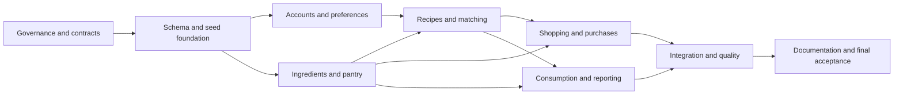
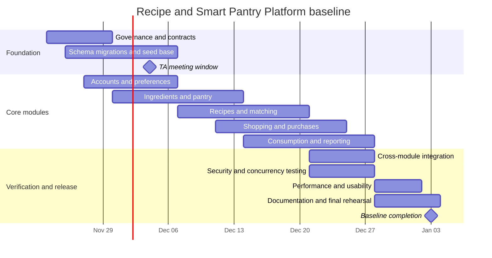

# Recipe and Smart Pantry Platform — Project Plan

## Cover Page

| Field | Value |
| --- | --- |
| Course | BBF 302E Database Systems |
| Project | Recipe and Smart Pantry Platform |
| Team | CHAOS |
| Term | Fall 2026 |
| Planning baseline | November 23, 2026–January 3, 2027 |
| Team leader | Can Sei Keçeci |
| Repository | [smart-pantry-platform](https://github.com/kececi24/smart-pantry-platform) |
| Plan version | 1.0 |

The plan ends on **January 3, 2027**, matching the GymTracker project-plan baseline. Dates other than the mandatory TA meeting are internal targets and must be updated if the official BBF 302E submission calendar differs.

## 1. Introduction

### 1.1 Scope

The Recipe and Smart Pantry Platform is a responsive web application for individuals who manage their own groceries. It connects pantry inventory, recipes, dietary preferences, shopping lists, confirmed purchases, and consumption history through a normalized MySQL database.

The implementation will support these core workflows:

- Register, sign in, sign out, maintain an account, and enforce member and administrator permissions.
- Store preferences for expiration alerts, recipe sorting, and dietary tags.
- Maintain canonical ingredients and compatible measurement units.
- Manage separately dated and located pantry lots with initial and remaining quantities.
- Distinguish available, expiring, expired, and depleted stock.
- Create, edit, publish, moderate, search, and scale recipes.
- Match recipes against pantry quantities and dietary preferences.
- Calculate recipe shortages and merge them into personal shopping lists.
- Confirm a purchase exactly once while adding the purchased quantity to the pantry.
- Record cooking and direct consumption through atomic per-lot deductions.
- Correct or delete consumption events while restoring earlier stock effects.
- Report monthly consumption by ingredient and commonly cooked recipe.

The delivery includes the database schema, migrations, seed data, Flask backend, responsive web interface, test evidence, benchmark fixtures, backup and restore instructions, and demonstration material.

The following extensions are outside the baseline:

- Shared household pantries.
- Retailer, price, delivery, or barcode integrations.
- Nutrition calculations or medical advice.
- Machine-learning recommendations.
- Native mobile applications and offline synchronization.
- Automatic conversion across incompatible measurement dimensions.
- A caching layer before indexed SQL queries and pagination are optimized.

### 1.2 Deliverables

| ID | Deliverable | Completion evidence |
| --- | --- | --- |
| D-01 | Project governance documents | Approved charter and maintained project plan with scope, ownership, estimates, schedule, and risks. |
| D-02 | Relational database | Versioned MySQL migrations create the 14 planned tables, keys, constraints, indexes, and reference data. |
| D-03 | Seed and benchmark data | Fixed-seed functional dataset plus 100,000-row pantry and 50,000-line recipe benchmark fixtures. |
| D-04 | Account and preference module | Registration, authentication, account state, preferences, and dietary selections pass owner and role tests. |
| D-05 | Ingredient and pantry module | Catalog and pantry CRUD, expiration views, compatible aggregation, and owner filtering work end to end. |
| D-06 | Recipe and matching module | Recipe CRUD, publication, dietary filtering, serving scaling, shortage calculation, and pantry matching work end to end. |
| D-07 | Shopping and purchase module | Shopping-list CRUD, shortage merging, purchase marking, and idempotent pantry confirmation pass transaction tests. |
| D-08 | Consumption and reporting module | Cooking, direct consumption, correction, deletion, history, and monthly reporting pass stock-integrity tests. |
| D-09 | Responsive web interface | Core workflows remain usable at 360 px and desktop widths with loading, validation, empty, and error states. |
| D-10 | Verification package | Automated, failure-injection, concurrency, authorization, performance, usability, and backup/restore evidence. |
| D-11 | Operations and demo package | Setup, migration, seed, test, backup, restore, and demonstration instructions verified from a clean checkout. |

### 1.3 Functional Requirements and Work Packages

| Task ID | Work package | Requirement coverage | Accountable owner |
| --- | --- | --- | --- |
| T-01 | Governance and technical baseline | Charter, plan, repository conventions, schema contract | Can |
| T-02 | Database and data foundation | Migrations, indexes, reference data, seeds, backup and restore | Selim |
| T-03 | Accounts and preferences | FR-01–03, FR-19 | Can |
| T-04 | Ingredients and pantry | FR-04–06, FR-20 | Hamza |
| T-05 | Recipes and matching | FR-07–10 | Ahmet |
| T-06 | Shopping and purchases | FR-11–14 | Ömer |
| T-07 | Consumption and reporting | FR-15–18 | Selim |
| T-08 | Integration and quality assurance | NFR-01–10 and cross-module acceptance | Can |
| T-09 | Documentation and demonstration | Setup, evidence, release notes, and demo | Can |

### 1.4 Non-Functional Baseline

| Area | Planned verification |
| --- | --- |
| Authentication | Argon2id hashes, signed JWT cookie validation, disabled-account rejection, token invalidation, and protected-route tests. |
| Authorization | Owner-scoped SQL and negative tests for guessed identifiers, cross-account access, and member attempts at admin operations. |
| SQL and input safety | Parameterized SQL, allowlisted sort fields, validation of dates, quantities and units, and injection fixtures. |
| Inventory performance | p95 below 500 ms for pantry search and expiration queries over 100 warmed requests on 100,000 pantry rows. |
| Recipe performance | p95 below one second for paginated matching over 100 requests on 200 recipes and a 50,000-line fixture. |
| Usability | Five peer testers complete add-food, find-recipe, and create-list tasks within three minutes each without guidance. |
| Matching correctness | Deterministic fixtures cover scaling, aggregation, expiry exclusion, unknown dates, dietary filtering, and shortages. |
| Purchase reliability | Retry, forced-failure, and simultaneous-confirmation tests prove exactly one pantry addition. |
| Transaction integrity | Concurrent last-quantity consumption never creates negative stock; failed mutations leave all affected tables unchanged. |
| Maintainability and recovery | Clean migration and test run, fixed-seed generation, backup restoration, and comparison of key row counts and aggregates. |

### 1.5 Technical Baseline

- **Database:** MySQL with InnoDB, foreign keys, unique and check constraints, decimal quantities, transactions, row locks, CTEs, window functions, and planned indexes.
- **Backend:** Python Flask API using `mysqlclient` and a small connection pool.
- **Data access:** Handwritten parameterized SQL; no ORM or automatic schema/code generator.
- **Frontend:** HTML, CSS, JavaScript, Flask templates, and fetch-based interaction.
- **Authentication:** Argon2id password hashes and signed JWT access tokens in HttpOnly cookies with a 30-minute expiration.
- **Request protection:** Secure cookies in deployment, `SameSite=Lax`, CSRF tokens for mutations, active-account checks, and token-version validation.
- **Data:** Fictional records generated by a deterministic Python seed process.
- **Change mechanism:** Numbered SQL migrations committed with the application code.

## 2. Work Breakdown Structure

Each activity has one accountable owner. Implementation activities include targeted tests, documentation of important decisions, and peer review. Large activities are kept at or below ten estimated hours so they can be completed within one planning week.

| Size | Reference effort |
| --- | --- |
| T — Tiny | Up to 2 hours |
| S — Small | 3–4 hours |
| M — Medium | 5–7 hours |
| L — Large | 8–10 hours |

| WBS ID | Parent | Activity | Owner | Size | Hours | Depends on | Completion condition |
| --- | --- | --- | --- | --- | ---: | --- | --- |
| WBS-1.1 | T-01 | Charter and plan baseline | Can | S | 4 | — | Scope, ownership, schedule, risks, and acceptance criteria are reviewed by the team. |
| WBS-1.2 | T-01 | Repository and local environment baseline | Can | M | 6 | WBS-1.1 | Flask starts, MySQL connectivity is documented, configuration uses example environment values, and the test command runs. |
| WBS-1.3 | T-01 | Shared schema and transaction contract | Selim | M | 6 | WBS-1.1 | Naming, quantity precision, unit rules, ownership, deletion behavior, and lock order are documented and reviewed. |
| WBS-2.1 | T-02 | Initial schema migrations | Selim | L | 8 | WBS-1.3 | All 14 planned tables, keys, checks, relationships, and rollback steps are implemented and tested. |
| WBS-2.2 | T-02 | Unit and ingredient reference data | Hamza | M | 5 | WBS-2.1 | Valid unit dimensions, multipliers, ingredient defaults, and uniqueness rules are seeded and tested. |
| WBS-2.3 | T-02 | Functional and benchmark seed generator | Hamza | L | 8 | WBS-2.1, WBS-2.2 | Fixed-seed functional data and both benchmark datasets are reproducible and satisfy referential integrity. |
| WBS-2.4 | T-02 | Backup and restore scripts | Ömer | S | 4 | WBS-2.1 | A seeded database is dumped and restored into an isolated database with matching key counts and aggregates. |
| WBS-3.1 | T-03 | Account registration and login services | Can | L | 8 | WBS-1.2, WBS-2.1 | Registration creates the account and preference row atomically; duplicate email and login cases pass. |
| WBS-3.2 | T-03 | JWT, cookie, CSRF, and logout controls | Can | L | 8 | WBS-3.1 | Protected routes validate token lifetime, account state, token version, CSRF, and secure cookie behavior. |
| WBS-3.3 | T-03 | Preferences and user dietary tags | Can | M | 6 | WBS-3.1, WBS-2.2 | Members read, update, reset, add, and remove only their own preference data. |
| WBS-3.4 | T-03 | Account maintenance and admin status controls | Can | S | 4 | WBS-3.2 | Members update their details; admins change role or status; password changes invalidate earlier tokens. |
| WBS-4.1 | T-04 | Ingredient and unit catalog | Hamza | M | 6 | WBS-2.2, WBS-3.2 | Public reads and admin writes work; deletion of referenced records is rejected. |
| WBS-4.2 | T-04 | Pantry-lot CRUD | Hamza | L | 8 | WBS-4.1 | Owner-scoped creation, reading, editing, and allowed deletion validate quantities, dates, units, and locations. |
| WBS-4.3 | T-04 | Inventory status and aggregation queries | Hamza | L | 8 | WBS-4.2, WBS-3.3 | Available, expiring, expired, and depleted views aggregate compatible lots and honor the alert window. |
| WBS-4.4 | T-04 | Pantry authorization and validation tests | Hamza | M | 6 | WBS-4.2, WBS-4.3 | Cross-account, invalid-unit, negative-stock, boundary-date, and referenced-delete cases pass. |
| WBS-5.1 | T-05 | Recipe CRUD and publication | Ahmet | L | 8 | WBS-3.2, WBS-2.1 | Owner-scoped draft CRUD and publish/unpublish rules work with moderation feedback. |
| WBS-5.2 | T-05 | Recipe lines and serving scaling | Ahmet | L | 8 | WBS-5.1, WBS-4.1 | Unique ingredient lines, compatible units, positive quantities, and serving scaling pass fixtures. |
| WBS-5.3 | T-05 | Dietary tags and recipe search | Ahmet | M | 6 | WBS-5.1, WBS-3.3 | Visibility, title, preparation-time, sort, and all-selected-tag filters work with pagination. |
| WBS-5.4 | T-05 | Pantry matching and shortage query | Ahmet | L | 10 | WBS-4.3, WBS-5.2, WBS-5.3 | Matching distinguishes full and partial matches, reports shortages, excludes expired stock, and ranks expiry use. |
| WBS-5.5 | T-05 | Recipe and matching interface | Ahmet | L | 8 | WBS-5.1–WBS-5.4 | Responsive recipe forms, search results, scaling, match status, and error states work against the API. |
| WBS-6.1 | T-06 | Shopping-list and item CRUD | Ömer | M | 6 | WBS-3.2, WBS-4.1 | Owned lists and unique ingredient lines support creation, editing, archive/reopen, and allowed deletion. |
| WBS-6.2 | T-06 | Recipe-shortage merge | Ömer | L | 8 | WBS-5.4, WBS-6.1 | Shortages create a new list or merge compatible unpurchased rows under a locked open list. |
| WBS-6.3 | T-06 | Idempotent purchase confirmation | Ömer | L | 8 | WBS-4.2, WBS-6.1 | Confirmation locks the item, creates one pantry lot, stores its link, and returns that link on retry. |
| WBS-6.4 | T-06 | Shopping interface and transaction tests | Ömer | L | 8 | WBS-6.1–WBS-6.3 | Responsive list flows pass retry, injected-failure, rollback, and simultaneous-confirmation tests. |
| WBS-7.1 | T-07 | Cooking and direct-consumption transaction | Selim | L | 10 | WBS-4.3, WBS-5.2 | Eligible lots are locked consistently, allocated FIFO, deducted, and recorded atomically. |
| WBS-7.2 | T-07 | Consumption correction and deletion | Selim | L | 8 | WBS-7.1 | Old deductions are restored before corrected lines are applied, and failed changes roll back completely. |
| WBS-7.3 | T-07 | History and monthly reporting queries | Selim | L | 8 | WBS-7.1 | Owner/date filters, ingredient totals, event counts, and most-cooked recipe results match fixtures. |
| WBS-7.4 | T-07 | Consumption and reporting interface | Ahmet | L | 8 | WBS-7.1–WBS-7.3 | Cooking, direct-use, history, correction, deletion, and dashboard flows work at mobile and desktop widths. |
| WBS-8.1 | T-08 | Cross-module acceptance suite | Can | M | 6 | WBS-3.4, WBS-4.4, WBS-5.5, WBS-6.4, WBS-7.4 | Seeded users complete the principal end-to-end scenarios without manual database repair. |
| WBS-8.2 | T-08 | Security negative-test suite | Hamza | M | 6 | WBS-8.1 | Protected endpoint groups reject missing, expired, disabled, wrong-role, cross-owner, CSRF, and injection cases. |
| WBS-8.3 | T-08 | Failure-injection and concurrency suite | Selim | M | 6 | WBS-6.3, WBS-7.2 | Purchase and consumption operations remain atomic under forced failure and simultaneous requests. |
| WBS-8.4 | T-08 | Performance measurement and query tuning | Hamza | M | 6 | WBS-2.3, WBS-4.3, WBS-5.4 | Both p95 targets are measured; query plans and any index changes are recorded. |
| WBS-8.5 | T-08 | Responsive and usability review | Ahmet | M | 5 | WBS-5.5, WBS-6.4, WBS-7.4 | Layout checks pass and five peer-test sessions produce recorded task times and findings. |
| WBS-8.6 | T-08 | Clean-install and recovery rehearsal | Ömer | S | 4 | WBS-2.4, WBS-8.1 | Another member follows setup instructions, restores a backup, and reproduces the test and seed results. |
| WBS-9.1 | T-09 | Setup, API, and database documentation | Can | M | 5 | WBS-8.1 | Environment, migrations, schema, endpoints, seed, and test commands are complete and current. |
| WBS-9.2 | T-09 | Test evidence and limitations report | Can | M | 5 | WBS-8.2–WBS-8.5 | Environment, datasets, commands, results, defects, and known limitations are consolidated. |
| WBS-9.3 | T-09 | Demonstration fixture and script | Ömer | S | 4 | WBS-8.1, WBS-9.1 | Stable seed accounts and an end-to-end demonstration script cover all major modules. |
| WBS-9.4 | T-09 | Final acceptance and rehearsal | Ömer | S | 4 | WBS-9.2, WBS-9.3 | The team completes the release checklist and rehearses the demonstration from a clean environment. |

## 3. Estimates

### 3.1 Effort Estimate by Work Package

One person-week equals 40 hours. The team will treat the estimates as planning values rather than time-reporting commitments.

| Work package | Baseline hours | Person-weeks |
| --- | ---: | ---: |
| T-01 Governance and technical baseline | 16 | 0.400 |
| T-02 Database and data foundation | 25 | 0.625 |
| T-03 Accounts and preferences | 26 | 0.650 |
| T-04 Ingredients and pantry | 28 | 0.700 |
| T-05 Recipes and matching | 40 | 1.000 |
| T-06 Shopping and purchases | 30 | 0.750 |
| T-07 Consumption and reporting | 34 | 0.850 |
| T-08 Integration and quality assurance | 33 | 0.825 |
| T-09 Documentation and demonstration | 18 | 0.450 |
| **Baseline total** | **250** | **6.250** |

### 3.2 Capacity and Reserve

The six-week baseline assumes an average of ten project hours per member per week.

| Capacity item | Hours |
| --- | ---: |
| Five members × six weeks × ten hours | 300 |
| Baseline planned work | 250 |
| Management reserve | 38 |
| Unallocated buffer after reserve | 12 |

The 38-hour reserve is approximately 15% of baseline effort. The team leader may release reserve for defects, underestimated integration, benchmark tuning, or course-requested corrections. Reserve is not used for out-of-scope features until all release-blocking acceptance criteria pass.

### 3.3 Estimation Assumptions

- Reusable owner-filter, validation, error-response, and transaction patterns reduce later module effort.
- Reviews and targeted tests are included in each activity rather than scheduled separately.
- The team has access to a local MySQL environment and ordinary development hardware.
- The application uses server-rendered templates plus focused JavaScript rather than a separate frontend framework.
- Generated data avoids external data-cleaning and licensing work.
- AI tools may assist with boilerplate, test-case drafts, and document editing, but owners remain responsible for correctness, security, review, and evidence.

## 4. Resources

### 4.1 Team Structure

| Member | Primary responsibility | Planned hours | Peer-review focus |
| --- | --- | ---: | --- |
| Can Sei Keçeci | Leadership, accounts, preferences, integration, documentation | 52 | API conventions, authentication, release readiness |
| Hamza Çevikbaş | Units, ingredients, pantry, security, performance | 53 | Validation, SQL safety, indexes, negative tests |
| Ahmet Abalı | Recipes, matching, frontend, usability | 53 | Responsive UI, query behavior, workflow clarity |
| Ömer Türk | Shopping, purchases, recovery rehearsal, demo | 46 | Transaction retry behavior, setup reproducibility |
| Selim Efe Aytemur | Schema, consumption, reporting, concurrency | 46 | Migrations, lock order, stock integrity, aggregates |
| **Total** |  | **250** |  |

### 4.2 Collaboration Rules

- The accountable owner implements or authors the activity and collects its completion evidence.
- Database migrations and shared transaction rules require review by Selim and one affected module owner.
- Can reviews authentication and integration changes; Hamza reviews SQL validation and performance-sensitive work.
- Ahmet reviews responsive interfaces; Ömer reviews shopping and retry flows; Selim reviews stock-changing transactions.
- Pull requests must state affected requirements, schema impact, test commands, and follow-up work.
- Security, authorization, data loss, negative stock, broken migration, and transaction-integrity defects block merging or release.
- The team holds one short weekly planning and risk review; detailed coordination remains in issues and pull requests.

### 4.3 Tools and Environments

| Resource | Planned use |
| --- | --- |
| Git and GitHub | Source control, pull requests, issue tracking, and release tagging |
| MySQL/InnoDB | Authoritative relational database and concurrency behavior |
| Python and Flask | Backend services, templates, validation, and scripts |
| `mysqlclient` | Raw-SQL database access and transaction control |
| HTML, CSS, JavaScript | Responsive user interface and fetch-based interactions |
| `mysqldump` and MySQL restore tools | Recovery rehearsal and release evidence |
| `EXPLAIN` and benchmark scripts | Query-plan validation and performance measurement |
| Fixed-seed generator | Repeatable functional, failure, and benchmark data |

## 5. Schedule

### 5.1 Dependency Sequence

The longest planned dependency chain is schema foundation → pantry and recipes → matching → shopping or consumption → integrated verification → final acceptance. Work on accounts, interface components, seeds, and documentation proceeds in parallel where dependencies allow.

### 5.2 Weekly Baseline

| Week | Dates | Primary outcomes |
| --- | --- | --- |
| Week 1 | Nov 23–Nov 29, 2026 | Governance baseline, repository setup, schema contract, first migrations, account and catalog foundations. |
| Week 2 | Nov 30–Dec 6, 2026 | Mandatory TA meeting, complete schema and seeds, authentication controls, preferences, pantry CRUD. |
| Week 3 | Dec 7–Dec 13, 2026 | Inventory queries, recipe CRUD, recipe lines, search, shopping-list foundation, initial responsive screens. |
| Week 4 | Dec 14–Dec 20, 2026 | Recipe matching, shortage merging, purchase confirmation, cooking and direct-consumption transactions. |
| Week 5 | Dec 21–Dec 27, 2026 | Consumption correction/reporting, integrated interfaces, security, failure, concurrency, and acceptance testing. |
| Week 6 | Dec 28, 2026–Jan 3, 2027 | Performance and usability validation, clean-install rehearsal, documentation, defect correction, final acceptance, and demo rehearsal. |

### 5.3 Gantt Chart

### 5.4 Milestones

| Milestone | Target date | Exit condition |
| --- | --- | --- |
| Planning baseline approved | Nov 29, 2026 | Scope, WBS, ownership, estimates, schedule, and risks reviewed. |
| Mandatory TA meeting completed | Nov 30–Dec 4, 2026 | All members attend and action items are recorded. |
| Database foundation complete | Dec 6, 2026 | Migrations, reference data, seed baseline, and rollback checks pass. |
| Primary feature implementation complete | Dec 20, 2026 | Core module workflows operate against the shared database. |
| Integrated release candidate | Dec 27, 2026 | End-to-end, authorization, rollback, retry, and concurrency cases pass. |
| Verification and documentation complete | Jan 2, 2027 | Performance, usability, recovery, and documentation evidence are reviewed. |
| Baseline project completion | **Jan 3, 2027** | Definition of Done and final acceptance checklist pass. |

### 5.5 Release Acceptance

Release requires all of the following:

- Numbered migrations apply successfully to an empty database and have documented rollback or forward-repair behavior.
- Core functional scenarios pass using fixed seed data.
- No open release-blocking security, ownership, data-loss, negative-stock, or migration defect remains.
- Purchase and consumption failure/retry/concurrency cases pass.
- Both benchmark targets are measured and results are documented, including deviations.
- Responsive and peer-usability checks are complete.
- Backup and restore rehearsal produces matching key counts and aggregates.
- Setup and test instructions work from a clean checkout.
- The demonstration fixture and script run without manual database modification.

## 6. Risks

### 6.1 Probability and Impact Register

Probability and impact use a 1–5 scale. Exposure equals probability × impact.

| ID | Risk | Probability | Impact | Exposure | Owner |
| --- | --- | ---: | ---: | ---: | --- |
| R-01 | Concurrent requests consume the same stock | 3 | 5 | 15 | Selim |
| R-02 | Purchase or consumption fails after a partial write | 3 | 5 | 15 | Ömer / Selim |
| R-03 | Unit conversion or decimal precision produces incorrect shortages | 3 | 4 | 12 | Hamza |
| R-04 | Owner filters or role checks are omitted | 2 | 5 | 10 | Can |
| R-05 | Recipe matching or pantry queries miss performance targets | 3 | 4 | 12 | Ahmet / Hamza |
| R-06 | Parallel module work causes migration or API conflicts | 3 | 4 | 12 | Can / Selim |
| R-07 | Responsive workflows are completed too late for usability fixes | 3 | 3 | 9 | Ahmet |
| R-08 | Optional features consume the reserve | 2 | 4 | 8 | Can |
| R-09 | Seed or benchmark data violate business rules | 3 | 3 | 9 | Hamza |
| R-10 | Clean setup, backup, or restore fails near delivery | 2 | 5 | 10 | Ömer |

### 6.2 Mitigation and Contingency Plan

| Risk | Preventive action | Trigger | Contingency |
| --- | --- | --- | --- |
| R-01 | Use consistent lock order, row locks, balance rechecks, and deterministic concurrency fixtures. | Negative balance, duplicate allocation, or deadlock in test. | Block release, isolate the transaction, simplify lock order, and repeat the full stock suite. |
| R-02 | Put all related writes in one transaction and add failure points between statements. | Any table changes after an injected failure. | Rework the transaction boundary and use reserve for regression testing. |
| R-03 | Centralize unit compatibility and base-unit conversion with decimal arithmetic. | Fixture mismatch or incompatible-unit acceptance. | Disable the affected conversion path until corrected; retain only exact compatible-unit operations. |
| R-04 | Reuse authenticated-user context and require owner predicates in every private query. | A negative authorization test returns private data or mutates another account. | Treat as release-blocking, patch all similar endpoints, and rerun the full negative suite. |
| R-05 | Design indexes from query access paths, paginate, inspect `EXPLAIN`, and benchmark early. | p95 exceeds its target by more than 10%. | Tune indexes and query shape; reduce nonessential result fields while preserving required behavior. |
| R-06 | Review schema changes, keep migrations small, and agree endpoint contracts before UI integration. | Conflicting migrations or repeated interface rework. | Freeze schema changes temporarily and hold a focused integration session led by Can and Selim. |
| R-07 | Build responsive shells alongside each module rather than after backend completion. | Core screens fail 360 px checks in Week 4. | Defer cosmetic enhancements and use reserve for primary-flow corrections. |
| R-08 | Keep the charter's out-of-scope list binding until release acceptance passes. | Optional work appears in the active iteration. | Remove it from the baseline and record it as future work. |
| R-09 | Generate data through the same validation and transaction services used by the application. | Seed load fails or creates invalid relationships. | Reduce the fixture, fix generation order, and regenerate from the same seed. |
| R-10 | Rehearse setup and restore before the final week. | Another member cannot reproduce the environment. | Correct scripts and instructions immediately; prepare a verified local fallback environment for the demo. |

## Appendix A. Requirements-to-WBS Traceability

| Requirement group | Primary WBS activities | Verification evidence |
| --- | --- | --- |
| FR-01–03, FR-19 Accounts and preferences | WBS-3.1–WBS-3.4 | Registration, authentication, token, owner, reset, and account-deletion tests |
| FR-04–06, FR-20 Ingredients and pantry | WBS-4.1–WBS-4.4 | Catalog, lot CRUD, expiration, aggregation, moderation, and validation tests |
| FR-07–10 Recipes and matching | WBS-5.1–WBS-5.5 | Publication, scaling, search, dietary, matching, shortage, and interface tests |
| FR-11–14 Shopping and purchase | WBS-6.1–WBS-6.4 | List CRUD, merge, retry, rollback, concurrent confirmation, and interface tests |
| FR-15–18 Consumption and reporting | WBS-7.1–WBS-7.4 | FIFO allocation, direct-use, restore, history, monthly summary, and interface tests |
| NFR-01–03 Security and input safety | WBS-3.2, WBS-4.4, WBS-8.2 | Authentication, authorization, CSRF, validation, and injection evidence |
| NFR-04–05 Performance | WBS-2.3, WBS-4.3, WBS-5.4, WBS-8.4 | Fixture description, query plans, environment, and p95 results |
| NFR-06 Usability | WBS-5.5, WBS-6.4, WBS-7.4, WBS-8.5 | Responsive checklist and five peer-test records |
| NFR-07 Matching correctness | WBS-5.2–WBS-5.4 | Independently specified deterministic fixtures |
| NFR-08–09 Transaction reliability | WBS-6.3, WBS-7.1–WBS-7.2, WBS-8.3 | Retry, failure-injection, rollback, and concurrency results |
| NFR-10 Maintainability and recovery | WBS-2.1–WBS-2.4, WBS-8.6, WBS-9.1 | Migrations, seed, clean setup, backup, restore, and documentation evidence |

## Appendix B. Definition of Done

An activity is done when:

- Its completion condition is met and demonstrated.
- Relevant functional and negative tests pass.
- Owner and role checks are included for private or privileged behavior.
- SQL is parameterized and important transaction boundaries are explicit.
- Any schema change has a numbered migration and updated documentation.
- User-facing behavior includes validation and useful empty and error states.
- A peer has reviewed the change.
- No new release-blocking defect is known.
- Requirement and WBS references are updated where applicable.

## Appendix C. Weekly Member Responsibilities

| Week | Can | Hamza | Ahmet | Ömer | Selim |
| --- | --- | --- | --- | --- | --- |
| 1 | Governance, environment, account start | Unit and ingredient seed | Recipe/UI preparation | Recovery-script preparation | Schema contract and migrations |
| 2 | Authentication and preferences | Seed generator and pantry CRUD | Recipe CRUD | Backup/restore and shopping foundation | Complete schema and review TA actions |
| 3 | Account integration | Inventory queries and tests | Recipe lines, search, responsive UI | Shopping lists and items | Consumption transaction preparation |
| 4 | Integration support | Pantry fixes and query review | Matching and shortages | Shortage merge and purchase confirmation | Consumption, correction, and reporting |
| 5 | End-to-end acceptance | Security negative tests | Consumption UI and responsive fixes | Shopping transaction regression | Concurrency and failure tests |
| 6 | Documentation and acceptance | Performance tuning | Usability review | Clean install and demo fixture | Integrity regression and result review |

## Reference Documents

- [Repository overview](../README.md)
- [Project proposal](Project_Proposal.md)
- [Milestone 2 ER diagram and data model](Milestone2.md)
- [Project charter](Charter.md)

## Changelog

| Version | Date | Change |
| --- | --- | --- |
| 1.0 | November 22, 2026 | Initial project-plan baseline ending January 3, 2027. |
