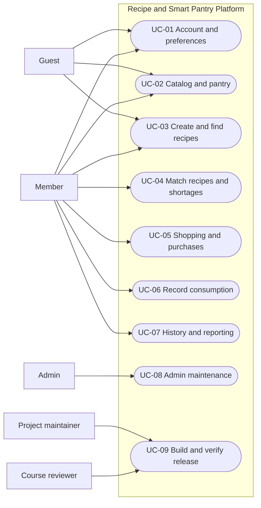
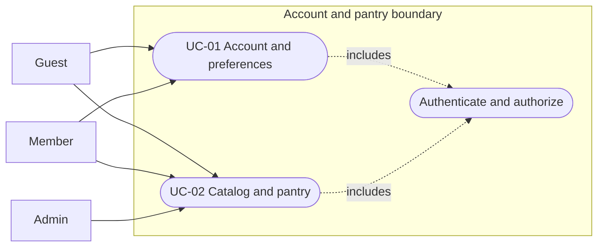
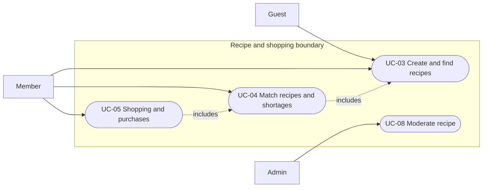
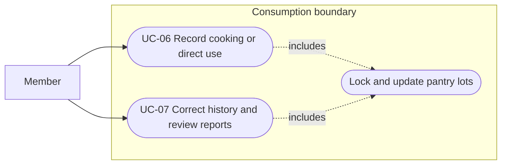
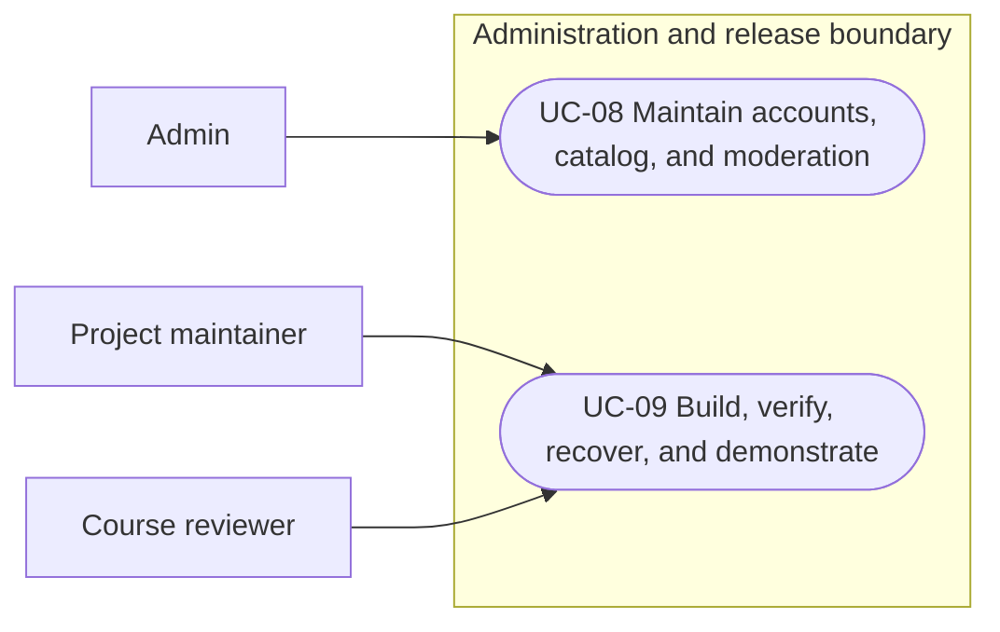

# BBF 302E Database Systems — Requirements Specification

## Cover Page

| Field | Details |
| --- | --- |
| **Course** | BBF 302E Database Systems |
| **Report name** | Requirements Specification |
| **Project title** | Recipe and Smart Pantry Platform |
| **Group name** | CHAOS |
| **Group members** | Can Sei Keçeci — 150240007; Hamza Çevikbaş — 150240025; Ahmet Abalı — 150240052; Ömer Türk — 150240323; Selim Efe Aytemur — 150230070 |
| **Term** | Fall 2026 |
| **Document date** | 2026-11-22 |
| **Document version** | 1.0 |

## Change Log

| Version | Date | Author(s) | Sections affected | Change type | Description |
| --- | --- | --- | --- | --- | --- |
| 1.0 | 2026-11-22 | Team CHAOS | All | Added | Initial requirements specification derived from the approved proposal, data model, project charter, project plan, and MVC architecture. |

## 1. Introduction

The Recipe and Smart Pantry Platform is a responsive web application for individuals who manage their own groceries. It stores food as separate pantry lots with quantities, compatible measurement units, locations, and expiration dates. It connects those lots to recipe search and matching, shopping lists, confirmed purchases, and consumption history so that users can decide what they can cook, what they need to buy, and which food should be used first.

This specification defines the mandatory functional and non-functional requirements for the project and states how each requirement will be accepted. Requirement identifiers remain consistent with the Project Proposal: `FR-01` through `FR-20` and `NFR-01` through `NFR-10`. Each functional requirement links to the Project Plan task, deliverable, scenarios, user stories, and use cases that implement or verify it.

The baseline uses Python, Flask, server-rendered Jinja templates, Bulma and project CSS, small JavaScript/fetch enhancements, MySQL/InnoDB, and handwritten parameterized SQL through `mysqlclient`. The application has Guest, Member, and Admin roles. Private pantry, shopping, and consumption data remain owner-scoped even for administrators.

Shared household pantries, retailer integrations, barcode recognition, nutrition calculations, machine-learning recommendations, native mobile applications, offline synchronization, and automatic conversion across incompatible measurement dimensions are outside the baseline.

## 2. System Requirements

### 2.1 Functional Requirements

All requirements in this section are mandatory for the baseline release.

| Requirement ID | Related task(s) | Related deliverable(s) | Functional requirement | Priority | Verification / acceptance condition |
| --- | --- | --- | --- | --- | --- |
| FR-01 | T-03 | D-04 | The system shall allow a Guest to register an account and shall create the account and its default preference record in one transaction after normalizing the email address. | Must | A valid registration creates exactly one `Users` row and one `UserPreferences` row; duplicate normalized email is rejected; an injected failure leaves neither row committed. |
| FR-02 | T-03 | D-04 | The system shall allow a user to sign in and sign out, allow a Member to update their own account details and password, and allow an Admin to disable an account or change its access role. | Must | Valid credentials create a protected session; invalid or disabled accounts are refused; logout clears the cookie; password or access changes invalidate earlier tokens; unauthorized role changes return `403`. |
| FR-03 | T-03 | D-04 | The system shall allow a Member to view, update, and reset their expiration-alert window, preferred recipe sort order, and dietary-tag selections. | Must | Saved settings and tags reappear after a new request; reset restores documented defaults; another account cannot read or change them. |
| FR-04 | T-04 | D-05 | The system shall allow all roles to browse and search canonical ingredients and units, and shall allow only an Admin to create or edit catalog entries or delete an unreferenced entry. | Must | Public searches return matching catalog rows; Admin changes persist; a Member receives `403` for maintenance actions; deletion of a referenced ingredient or unit is rejected. |
| FR-05 | T-04 | D-05, D-09 | The system shall allow a Member to create, view, and edit their own pantry lots and to delete only an empty lot that has no consumption or confirmed-purchase reference. | Must | Valid lots persist with owner, ingredient, unit, quantities, dates, and location; cross-owner access is rejected; invalid quantities or units are not saved; protected references prevent deletion. |
| FR-06 | T-04 | D-05, D-09 | The system shall classify a Member's pantry lots as available, expiring, expired, or depleted and shall aggregate usable quantities only across compatible units while supporting ingredient and location filters. | Must | Deterministic fixtures match expected classifications and totals; expired and depleted lots do not contribute usable stock; unknown dates do not produce an expiration alert; results contain only the authenticated owner's lots. |
| FR-07 | T-05 | D-06, D-09 | The system shall allow a Member to create, edit, and delete an owned recipe draft and to publish or unpublish it after validating required instructions and at least one ingredient line. | Must | Draft CRUD is owner-scoped; invalid publication is rejected; valid publication becomes visible to other users; deleting or editing another user's recipe is rejected. |
| FR-08 | T-05 | D-06, D-09 | The system shall allow a recipe owner to add, edit, or remove ingredient requirements and shall scale compatible required quantities to a selected positive serving count. | Must | Unique recipe/ingredient lines persist with positive quantities; incompatible units and nonpositive servings are rejected; scaled fixture results match independent calculations. |
| FR-09 | T-05 | D-06, D-09 | The system shall allow a Guest, Member, or Admin to search recipes visible to that actor by title, preparation time, dietary compatibility, and an allowlisted sort order and to view recipe requirements and instructions. | Must | Guests see published recipes only; owners also see their drafts; filters and pagination return expected seeded records; an invisible recipe returns a privacy-preserving denial. |
| FR-10 | T-05 | D-06, D-09 | The system shall compare visible recipes with a Member's usable pantry quantities, distinguish fully cookable recipes from recipes with shortages, and rank results using expiring-stock use. | Must | Fixtures verify serving scaling, compatible-unit aggregation, expired-lot exclusion, dietary filtering, shortages, and ranking; another user's pantry never contributes stock. |
| FR-11 | T-06 | D-07, D-09 | The system shall allow a Member to create, rename, view, archive, reopen, and delete owned shopping lists and their item lines, subject to preservation rules for confirmed pantry records. | Must | Owner-scoped list operations persist; archived-list rules are enforced; deleting a list removes its lines without deleting pantry lots created by confirmed purchases. |
| FR-12 | T-06 | D-07, D-09 | The system shall allow a Member to add, edit, remove, and mark shopping items as purchased while keeping at most one row per ingredient in a list and retaining each requested quantity. | Must | Duplicate ingredient additions merge or are rejected according to the documented rule; invalid quantities are rejected; purchase status changes persist; another owner cannot modify the item. |
| FR-13 | T-06 | D-07 | The system shall calculate missing amounts for a selected recipe and serving count and shall add them to a new shopping list or merge compatible amounts into an existing owned open list. | Must | Fixture shortages match the recipe-matching result; compatible unpurchased rows merge once under a lock; purchased or incompatible rows produce the documented conflict or a new line/list outcome. |
| FR-14 | T-06 | D-07 | The system shall confirm a shopping purchase by creating one pantry lot and linking it to the shopping item in the same transaction, and shall return the existing linked lot when confirmation is retried. | Must | First confirmation creates one lot and one link; repeated confirmation creates no additional stock; forced failure rolls back both changes; simultaneous requests produce one creation and one existing/conflict result. |
| FR-15 | T-07 | D-08, D-09 | The system shall record cooking for a selected recipe and positive serving count by locking eligible owned lots, allocating compatible deductions in first-in-first-out order, and creating one event with per-lot detail lines atomically. | Must | Sufficient-stock fixtures create the expected event and deductions; insufficient stock changes nothing; concurrent requests cannot create negative stock; event detail totals equal lot reductions. |
| FR-16 | T-07 | D-08, D-09 | The system shall record direct consumption for one selected ingredient and positive quantity without requiring a recipe and shall deduct that quantity atomically from compatible owned pantry lots. | Must | A valid direct event has no recipe or serving count and deducts the expected lots; mixed-ingredient, incompatible-unit, insufficient-stock, and cross-owner requests are rejected without mutation. |
| FR-17 | T-07 | D-08, D-09 | The system shall allow a Member to filter their consumption history and to correct or delete an owned event through a transaction that restores the previous deductions before applying replacement deductions or removing the event. | Must | History filters return only owned events; correction and deletion restore expected balances; forced failure preserves the original event and stock; another owner cannot access the event. |
| FR-18 | T-07 | D-08, D-09 | The system shall display a Member's monthly quantities consumed by ingredient and canonical unit, event counts, and most frequently cooked recipes. | Must | A fixed monthly fixture matches independently calculated totals; the half-open month range excludes adjacent dates; cooking-event counts are not multiplied by detail rows. |
| FR-19 | T-03 | D-04 | The system shall allow a Member to reset preferences or delete their account through a guided workflow that removes dependent owned records in a valid order after identity verification. | Must | Preference reset restores defaults; a successful deletion removes or clears dependent data as documented; an interrupted transaction leaves the account and dependencies unchanged. |
| FR-20 | T-04, T-05 | D-05, D-06 | The system shall allow an Admin to unpublish a published recipe with a recorded moderation reason and shall allow the owner to review, edit, and resubmit it. | Must | Admin moderation changes status and saves a reason; a Member cannot moderate another recipe; the owner can view the reason and successfully resubmit after correction. |

**Functional rules and assumptions**

- Guest access is unauthenticated. Member and Admin accounts are stored in `Users`; Admin status does not bypass ownership of private pantry, shopping, or consumption records.
- Quantities use decimal arithmetic. Conversion is permitted only between units in the same measurement dimension and passes through the dimension's base unit.
- Usable pantry stock excludes expired and depleted lots. A lot with no expiration date may contribute usable stock but cannot trigger an expiration alert.
- Marking a shopping item as purchased and confirming it into the pantry are distinct states. A confirmed item has a purchase flag and a linked pantry lot.
- A cooking event requires a recipe and positive serving count. A direct event has neither and represents one ingredient. Every detail line references one pantry lot owned by the event owner.
- Stock-changing transactions lock rows in a documented consistent order and recheck balances after acquiring locks.
- Restrictive foreign keys preserve referenced history unless a documented account-deletion workflow removes dependencies safely.

### 2.2 Non-Functional Requirements

| Requirement ID | Quality attribute | Non-functional requirement | Applies to | Verification / measurement |
| --- | --- | --- | --- | --- |
| NFR-01 | Authentication | The system shall store only Argon2id password hashes and shall reject protected requests without a valid, unexpired token or from a disabled account. | FR-01–FR-03, FR-19 | Inspect stored credentials and execute positive, missing-token, expired-token, invalid-signature, token-version, and disabled-account tests for every protected endpoint group. |
| NFR-02 | Authorization | Every private `SELECT`, `UPDATE`, and `DELETE` shall filter by the authenticated user identifier; Admin-only actions shall reject Members. | FR-02–FR-20 | Execute guessed-ID and cross-account tests for each owner-scoped resource and wrong-role tests for account, catalog, and moderation actions. |
| NFR-03 | SQL and input safety | The system shall parameterize every external SQL value, allowlist dynamic ordering, and reject malformed dates, incompatible units, negative stock, and nonpositive line quantities before mutation. | Whole system | Code review plus injection, invalid-input, and unchanged-database fixtures. |
| NFR-04 | Inventory performance | Pantry search and expiration queries shall target p95 server latency below 500 ms over 100 measured requests after warm-up on the documented local environment with 100,000 pantry rows. | FR-05–FR-06 | Record hardware, dataset, endpoint/query mix, `EXPLAIN` plans, samples, and p95 latency. |
| NFR-05 | Recipe performance | Paginated recipe matching shall target p95 server latency below one second over 100 measured requests on 200 recipes and a separate 50,000-line recipe fixture. | FR-08–FR-10, FR-13 | Record hardware, dataset, pagination, query plan, samples, and p95 latency. |
| NFR-06 | Usability | Inventory, recipe matching, and shopping flows shall remain usable at 360 px and desktop widths; five peer testers shall complete add-food, find-recipe, and create-list tasks within three minutes per task without guidance. | FR-05–FR-14 | Responsive checklist plus recorded task outcomes, times, and findings from five peer testers. |
| NFR-07 | Matching correctness | Recipe matching shall deterministically handle serving scaling, compatible-lot aggregation, expired-lot exclusion, unknown dates, dietary filtering, and missing quantities. | FR-08–FR-10, FR-13 | Compare query and UI results with independently specified deterministic fixtures. |
| NFR-08 | Purchase reliability | Repeated confirmation shall create exactly one pantry addition; forced failure shall roll back list and pantry changes; simultaneous confirmations shall not duplicate stock. | FR-14 | Retry, injected-failure, and two-request concurrency tests against MySQL/InnoDB. |
| NFR-09 | Transaction integrity | Concurrent consumption of the final available quantity shall never create negative stock, and failed cooking, correction, or deletion shall leave stock and event rows unchanged. | FR-15–FR-17 | Two-request concurrency tests and injected failures at each multi-step transaction boundary. |
| NFR-10 | Maintainability and recovery | The project shall provide numbered raw-SQL migrations, a fixed-seed generator, setup and test instructions, and a MySQL backup/restore procedure; no ORM or automatic schema generator shall be used. | Whole system | From a clean checkout, build the schema, generate data, run checks, restore a `mysqldump`, and compare row counts and key aggregates. |

**Non-functional assumptions**

- Performance results are environment-specific and must record the development hardware, MySQL version, fixture sizes, warm-up, query mix, and sample count.
- Security, ownership, negative-stock, migration, and data-loss defects block release.
- Server-rendered behavior remains the functional fallback when JavaScript enhancement is unavailable.
- Test and seed records are fictional and contain no real personal information.

## 3. Use Cases

### 3.1 User Types

| User type ID | User type / actor | Description and responsibilities | Goals / typical actions | Related requirement IDs |
| --- | --- | --- | --- | --- |
| UT-01 | Guest | A visitor without an authenticated account. | Browse public recipes and ingredients, view recipe details, register, and sign in. | FR-01, FR-04, FR-09 |
| UT-02 | Member | An authenticated owner of personal pantry, recipe, shopping, and consumption data. | Maintain private data, publish recipes, match recipes, confirm purchases, and review consumption. | FR-02–FR-19 |
| UT-03 | Admin | An authenticated maintenance role with the same private-record ownership boundary as a Member. | Maintain account state, ingredient catalog entries, and published-recipe moderation. | FR-02, FR-04, FR-20 |
| UT-04 | Project maintainer | A team member who applies migrations, seeds data, runs tests and benchmarks, restores backups, and prepares the release. This is an operational role, not an application role. | Build, verify, recover, document, and demonstrate the application. | NFR-01–NFR-10 |
| UT-05 | Course reviewer | An instructor or teaching assistant who reviews milestone evidence and the final system. | Evaluate traceability, database design, working behavior, and verification evidence. | NFR-04–NFR-10 |

**Access distinctions.** Guests can access only public catalog and published-recipe behavior. Members can read and modify only their own private records. Admins have explicit maintenance actions but cannot browse another Member's pantry, shopping lists, or consumption history. Project-maintainer access belongs to the development environment and does not create an in-application superuser.

### 3.2 User Scenarios

#### Personas

| Persona ID | Persona | User type | Goals and context | Relevant needs or constraints |
| --- | --- | --- | --- | --- |
| P-01 | Elif, a busy home cook | UT-02 Member | Track food after weekly shopping and choose meals before ingredients expire. | Fast mobile-width entry, clear expiry states, accurate quantities, and simple recipe matches. |
| P-02 | Mert, a recipe contributor | UT-02 Member | Create recipes, publish useful instructions, and understand pantry shortages for different servings. | Draft ownership, serving scaling, dietary tags, and clear validation. |
| P-03 | Derya, a catalog administrator | UT-03 Admin | Keep ingredient data consistent and moderate an unsuitable published recipe. | Role-restricted controls, reference checks, moderation reasons, and no access to private member data. |
| P-04 | Bora, a prospective user | UT-01 Guest | Browse public recipes before deciding to register. | Useful public search with a clear sign-in boundary for private features. |
| P-05 | Team maintainer | UT-04 Project maintainer | Reproduce, verify, recover, and demonstrate the release from version-controlled artifacts. | Deterministic migrations and seeds, documented commands, benchmark fixtures, and recorded results. |

#### Scenario Narratives

**SC-01 — Register and configure a personal account**  
**Persona:** P-01 — Elif  
**Related requirements:** FR-01–FR-03, FR-19

Elif registers with her email and password. The system creates her account and default preferences together and starts an authenticated session. She adjusts the expiration alert window, recipe sort order, and dietary tags. On a later visit, those values are still present. If she changes her password, earlier sessions no longer work.

**SC-02 — Track groceries and expiry**  
**Persona:** P-01 — Elif  
**Related requirements:** FR-04–FR-06

After shopping, Elif selects canonical ingredients and units and records each package as a separate pantry lot. She stores quantities, locations, and known expiration dates. The pantry page groups compatible amounts while still showing physical lots and highlights stock that is available, expiring, expired, or depleted. A package without an expiration date remains usable but does not generate an alert.

**SC-03 — Create, publish, and find recipes**  
**Personas:** P-02 — Mert; P-04 — Bora  
**Related requirements:** FR-07–FR-09, FR-20

Mert creates a recipe draft, adds ingredient quantities and dietary tags, and publishes it after entering instructions. Bora searches the public catalog and can read the published recipe but not Mert's drafts. If an Admin unpublishes the recipe with a reason, Mert reviews the reason, edits the draft, and resubmits it.

**SC-04 — Match a recipe and prepare a shopping list**  
**Persona:** P-01 — Elif  
**Related requirements:** FR-08, FR-10–FR-14

Elif selects a serving count and asks for recipes she can cook. The system scales recipe lines, aggregates compatible usable pantry lots, excludes expired stock, and shows fully cookable and shortage results. She adds shortages to an open shopping list. After buying an item, she confirms it with lot details; the list and pantry update together, and retrying the confirmation does not add the food twice.

**SC-05 — Cook, correct history, and review a month**  
**Persona:** P-01 — Elif  
**Related requirements:** FR-15–FR-18

Elif records cooking a recipe. The system locks eligible lots, deducts in first-in-first-out order, and stores exact per-lot details. She later corrects the event; the system restores the old deductions before applying the replacement. The monthly report shows ingredient totals, event counts, and commonly cooked recipes without mixing another Member's data.

**SC-06 — Maintain public data and moderate content**  
**Persona:** P-03 — Derya  
**Related requirements:** FR-02, FR-04, FR-20

Derya signs in as an Admin, corrects an ingredient entry, and attempts to delete an ingredient. The system refuses deletion when a recipe or pantry lot references it. She reviews a published recipe, unpublishes it with a reason, and leaves the owner's private inventory inaccessible.

**SC-07 — Build, verify, recover, and demonstrate the release**  
**Personas:** P-05 — Team maintainer; UT-05 Course reviewer  
**Related requirements:** NFR-01–NFR-10

The maintainer starts from a clean checkout, applies migrations, generates fixed-seed data, and runs the automated and manual verification suites. The team measures the two performance targets on recorded fixtures, completes five usability sessions, injects transaction failures, and runs concurrency cases. The maintainer restores a backup into an isolated database and prepares a repeatable demonstration for the reviewer.

#### User Stories Linked to the Project Plan

Every Project Plan WBS activity appears below. User-facing activities use the normal user-story form; technical and verification activities state the stakeholder value they provide.

| Story ID | Scenario | WBS activity | User story or technical activity | Related requirements |
| --- | --- | --- | --- | --- |
| US-01 | SC-07 | WBS-1.1 | As a course reviewer, I want an agreed charter and plan so that scope, ownership, dates, and acceptance are explicit. | NFR-10 |
| US-02 | SC-07 | WBS-1.2 | As a maintainer, I want a reproducible local environment so that the application and tests start from documented configuration. | NFR-10 |
| US-03 | SC-07 | WBS-1.3 | Technical: define shared naming, quantity, unit, ownership, deletion, transaction, and lock-order rules before module implementation. | NFR-03, NFR-08–NFR-10 |
| US-04 | SC-07 | WBS-2.1 | As a maintainer, I want versioned migrations so that the 14-table schema can be created and reviewed consistently. | NFR-10 |
| US-05 | SC-02 | WBS-2.2 | As a Member, I want consistent units and ingredient references so that pantry and recipe quantities are comparable. | FR-04–FR-06, FR-08, FR-10 |
| US-06 | SC-07 | WBS-2.3 | As a maintainer, I want deterministic functional and benchmark data so that tests and measurements are repeatable. | NFR-04–NFR-05, NFR-07–NFR-10 |
| US-07 | SC-07 | WBS-2.4 | As a maintainer, I want a rehearsed backup and restore process so that the project data can be recovered. | NFR-10 |
| US-08 | SC-01 | WBS-3.1 | As a Guest, I want to register and sign in so that I can use private pantry features. | FR-01–FR-02 |
| US-09 | SC-01 | WBS-3.2 | As a Member, I want protected cookie sessions and safe logout so that unauthorized requests cannot use my account. | FR-02, NFR-01–NFR-02 |
| US-10 | SC-01 | WBS-3.3 | As a Member, I want to manage expiration, sorting, and dietary preferences so that results reflect my needs. | FR-03 |
| US-11 | SC-01, SC-06 | WBS-3.4 | As a Member, I want to maintain my account, while an Admin needs restricted status controls, so account lifecycle remains manageable. | FR-02, FR-19 |
| US-12 | SC-02, SC-06 | WBS-4.1 | As a visitor, I want to browse consistent ingredients, while an Admin needs safe maintenance controls. | FR-04 |
| US-13 | SC-02 | WBS-4.2 | As a Member, I want to manage separate pantry lots so that quantities and expiration dates remain accurate. | FR-05 |
| US-14 | SC-02 | WBS-4.3 | As a Member, I want inventory totals and expiry classifications so that I know what is usable and what to consume first. | FR-06 |
| US-15 | SC-02 | WBS-4.4 | Technical: verify pantry ownership, dates, units, quantities, and deletion rules against negative fixtures. | FR-05–FR-06, NFR-02–NFR-04 |
| US-16 | SC-03 | WBS-5.1 | As a Member, I want to draft and publish recipes so that I can maintain and share cooking instructions. | FR-07, FR-20 |
| US-17 | SC-03, SC-04 | WBS-5.2 | As a recipe owner, I want ingredient lines to scale by servings so that required amounts remain correct. | FR-08 |
| US-18 | SC-03 | WBS-5.3 | As a visitor, I want to search visible recipes by useful filters so that I can find suitable meals. | FR-09 |
| US-19 | SC-04 | WBS-5.4 | As a Member, I want recipes compared with my pantry so that I can distinguish cookable meals from shortages. | FR-10, FR-13, NFR-05, NFR-07 |
| US-20 | SC-03, SC-04 | WBS-5.5 | As a user, I want responsive recipe and matching screens so that I can complete the workflow on mobile or desktop. | FR-07–FR-10, NFR-06 |
| US-21 | SC-04 | WBS-6.1 | As a Member, I want to maintain open and archived shopping lists so that planned purchases stay organized. | FR-11–FR-12 |
| US-22 | SC-04 | WBS-6.2 | As a Member, I want shortages merged into an open list so that I do not re-enter missing ingredients. | FR-13 |
| US-23 | SC-04 | WBS-6.3 | As a Member, I want purchase confirmation to add pantry stock exactly once so that retries cannot inflate inventory. | FR-14, NFR-08 |
| US-24 | SC-04 | WBS-6.4 | Technical: verify the shopping interface, rollback, retry, and simultaneous confirmation behavior. | FR-11–FR-14, NFR-06, NFR-08 |
| US-25 | SC-05 | WBS-7.1 | As a Member, I want cooking and direct use to deduct the correct lots atomically so that pantry balances remain trustworthy. | FR-15–FR-16, NFR-09 |
| US-26 | SC-05 | WBS-7.2 | As a Member, I want to correct or delete an event so that history and restored stock remain consistent. | FR-17, NFR-09 |
| US-27 | SC-05 | WBS-7.3 | As a Member, I want history and monthly summaries so that I can understand what I consumed. | FR-17–FR-18 |
| US-28 | SC-05 | WBS-7.4 | As a Member, I want responsive consumption and reporting screens so that I can record and review activity easily. | FR-15–FR-18, NFR-06 |
| US-29 | SC-07 | WBS-8.1 | As a reviewer, I want end-to-end acceptance evidence so that the major modules are proven to work together. | FR-01–FR-20 |
| US-30 | SC-07 | WBS-8.2 | As a Member, I want negative security cases tested so that private records and privileged actions remain protected. | NFR-01–NFR-03 |
| US-31 | SC-07 | WBS-8.3 | As a reviewer, I want failure and concurrency evidence so that purchase and consumption integrity is demonstrated. | NFR-08–NFR-09 |
| US-32 | SC-07 | WBS-8.4 | As a reviewer, I want reproducible performance measurements so that query targets can be evaluated objectively. | NFR-04–NFR-05 |
| US-33 | SC-07 | WBS-8.5 | As a user, I want responsive workflows tested by peers so that common tasks are understandable and timely. | NFR-06 |
| US-34 | SC-07 | WBS-8.6 | As a maintainer, I want another member to reproduce setup and recovery so that instructions are dependable. | NFR-10 |
| US-35 | SC-07 | WBS-9.1 | As a maintainer, I want current setup, API, schema, seed, and test documentation so that the release can be reproduced. | NFR-10 |
| US-36 | SC-07 | WBS-9.2 | As a reviewer, I want consolidated test results and limitations so that project quality is transparent. | NFR-01–NFR-10 |
| US-37 | SC-07 | WBS-9.3 | As a reviewer, I want a stable seed fixture and demo script so that major workflows can be assessed consistently. | FR-01–FR-20 |
| US-38 | SC-07 | WBS-9.4 | As a team, we want a final acceptance rehearsal so that the January 3, 2027 baseline closes with known evidence and no manual database repair. | FR-01–FR-20, NFR-01–NFR-10 |

### 3.3 Use Case Diagrams

The diagrams use Mermaid flowchart notation. Actors appear outside the system boundary and use cases inside it. Dashed arrows marked “includes” show a required supporting goal rather than a separate optional feature.

#### 3.3.1 Whole-System Diagram

#### 3.3.2 Account and Pantry

**Coverage:** T-03, T-04 / FR-01–FR-06, FR-19 / UC-01–UC-02

#### 3.3.3 Recipes, Matching, and Shopping

**Coverage:** T-05, T-06 / FR-07–FR-14, FR-20 / UC-03–UC-05

#### 3.3.4 Consumption and Reporting

**Coverage:** T-07 / FR-15–FR-18 / UC-06–UC-07

#### 3.3.5 Administration and Release Operations

**Coverage:** T-01, T-02, T-08, T-09 / FR-02, FR-04, FR-20, NFR-01–NFR-10 / UC-08–UC-09

### 3.4 Detailed Use Cases

#### 3.4.1 Use Case Coverage Matrix

| Project Plan task | Functional requirements | Use cases | Scenarios |
| --- | --- | --- | --- |
| T-01 | Technical baseline supporting all requirements | UC-09 | SC-07 |
| T-02 | Data foundation supporting FR-01–FR-20 | UC-09 | SC-07 |
| T-03 | FR-01–FR-03, FR-19 | UC-01 | SC-01 |
| T-04 | FR-04–FR-06, FR-20 | UC-02, UC-08 | SC-02, SC-06 |
| T-05 | FR-07–FR-10, FR-20 | UC-03, UC-04, UC-08 | SC-03, SC-04, SC-06 |
| T-06 | FR-11–FR-14 | UC-05 | SC-04 |
| T-07 | FR-15–FR-18 | UC-06, UC-07 | SC-05 |
| T-08 | Verification of FR-01–FR-20 and NFR-01–NFR-10 | UC-09 | SC-07 |
| T-09 | Delivery of reproducible evidence | UC-09 | SC-07 |

#### 3.4.2 UC-01 — Manage Account and Preferences

| Field | Description |
| --- | --- |
| **Use case ID** | UC-01 |
| **Goal** | Establish and maintain a protected personal account and preference profile. |
| **Primary actors** | UT-01 Guest; UT-02 Member |
| **Related tasks** | T-03 |
| **Related requirements** | FR-01–FR-03, FR-19 |

**Preconditions:** Registration requires no active session. Preference, account-maintenance, reset, and deletion actions require an authenticated active Member.

**Main success flow:**

1. The Guest opens registration and submits a name, email, and password.
2. The system normalizes the email, validates input, hashes the password with Argon2id, and creates the account and default preference record in one transaction.
3. The user signs in and the system issues the protected cookie session.
4. The Member opens preferences and the system displays the current alert window, sort order, and dietary tags.
5. The Member changes values and submits the form with a valid CSRF token.
6. The system validates and saves only that Member's values and confirms the update.
7. The Member later changes account details or password; a password change invalidates earlier tokens.

**Alternative flows:**

- **A1 — Reset preferences (branches from step 4):** The Member requests reset, confirms the action, and the system restores documented defaults and clears selected dietary tags.
- **A2 — Logout (branches after step 3):** The Member submits logout; the system invalidates the session state as designed and clears the authentication cookie.
- **A3 — Delete account (branches after step 3):** After identity confirmation, the system removes dependent owned records in the documented order within one transaction and ends the session.

**Exception flows:**

- **E1 — Duplicate normalized email (step 2):** The system reports that the address is unavailable and commits neither the account nor preference row.
- **E2 — Invalid, expired, or disabled session (steps 4–7):** The system rejects the request without exposing or changing private data.
- **E3 — Validation or transaction failure (steps 5–7):** The system shows a recoverable error and preserves the last committed state.

**Postconditions:** A successful account has one default preference profile. Successful changes are owner-scoped and persistent. Logout, password change, access change, and deletion have the documented token effects.

#### 3.4.3 UC-02 — Maintain Catalog and Pantry Inventory

| Field | Description |
| --- | --- |
| **Use case ID** | UC-02 |
| **Goal** | Browse consistent catalog data and maintain accurate, owner-scoped physical pantry lots. |
| **Primary actors** | UT-01 Guest; UT-02 Member; UT-03 Admin |
| **Related tasks** | T-04 |
| **Related requirements** | FR-04–FR-06 |

**Preconditions:** Catalog browsing is public. Pantry actions require an authenticated Member. Catalog mutation requires Admin role.

**Main success flow:**

1. The actor searches the ingredient catalog.
2. The system returns canonical ingredients with their categories and default compatible units.
3. A Member opens the pantry and selects an ingredient, unit, initial quantity, remaining quantity, storage location, and optional expiration date.
4. The system validates owner, unit dimension, quantities, and dates and inserts a separate pantry lot.
5. The Member views the pantry with ingredient, location, and status filters.
6. The system classifies each lot and returns compatible totals and the earliest known expiration where applicable.
7. The Member edits an owned lot and the system saves valid changes.

**Alternative flows:**

- **A1 — Unknown expiration date (step 3):** The Member leaves the date empty; the lot may be usable but is not classified as expiring.
- **A2 — Delete empty unreferenced lot (after step 5):** The system verifies ownership, zero remaining quantity, and absence of protected references before deletion.
- **A3 — Admin maintains catalog (after step 2):** The Admin creates or edits a valid catalog entry; the system enforces canonical-name and unit rules.

**Exception flows:**

- **E1 — Incompatible unit or invalid quantity (step 4):** The system identifies the invalid field and does not insert or change the lot.
- **E2 — Cross-owner access (steps 5–7):** The system returns `403` or privacy-preserving `404` and makes no change.
- **E3 — Referenced catalog or pantry record (deletion path):** The system refuses deletion and explains the preservation rule.

**Postconditions:** Successful lot changes affect only the authenticated owner's inventory. Aggregates and status views reflect the committed lot state.

#### 3.4.4 UC-03 — Create, Publish, Search, and View Recipes

| Field | Description |
| --- | --- |
| **Use case ID** | UC-03 |
| **Goal** | Maintain an owned recipe and make valid recipes discoverable according to visibility and search rules. |
| **Primary actors** | UT-01 Guest; UT-02 Member |
| **Related tasks** | T-05 |
| **Related requirements** | FR-07–FR-09 |

**Preconditions:** Public search requires no session. Recipe creation and editing require an authenticated Member. Ingredients, units, and dietary tags exist.

**Main success flow:**

1. A Member creates a recipe draft with title, instructions, base servings, preparation time, and supported metadata.
2. The Member adds ingredient lines with positive quantities and compatible units and selects dietary tags.
3. The system validates ownership, unique ingredient lines, values, units, and tag references and saves the draft.
4. The Member requests publication.
5. The system verifies nonblank instructions and at least one valid ingredient line, then marks the recipe published.
6. A Guest or Member searches by title, preparation time, dietary compatibility, and an allowlisted sort order.
7. The system applies visibility first, paginates results, and displays the selected recipe and scaled requirements.

**Alternative flows:**

- **A1 — Owner keeps a draft (after step 3):** The recipe remains visible only to its owner and eligible Admin moderation views.
- **A2 — Owner changes servings while viewing (step 7):** The system recalculates display quantities without changing the stored base quantities.
- **A3 — Owner unpublishes (after step 5):** The recipe returns to draft and no longer appears in public results.

**Exception flows:**

- **E1 — Invalid publication (step 5):** The system lists missing instructions or ingredient lines and keeps the recipe as a draft.
- **E2 — Duplicate line or incompatible unit (step 3):** The system rejects the line and keeps the other valid draft state.
- **E3 — Invisible or cross-owner recipe (steps 3 or 7):** The system denies access without revealing private content.

**Postconditions:** A valid published recipe is searchable; an owned draft remains private; stored base quantities are unchanged by display scaling.

#### 3.4.5 UC-04 — Match Recipes and Calculate Shortages

| Field | Description |
| --- | --- |
| **Use case ID** | UC-04 |
| **Goal** | Compare visible recipe requirements with the Member's usable pantry stock for a selected serving count. |
| **Primary actor** | UT-02 Member |
| **Related tasks** | T-05 |
| **Related requirements** | FR-08, FR-10, FR-13 |

**Preconditions:** The Member is authenticated; visible recipes have valid lines; pantry lots and preferences are available.

**Main success flow:**

1. The Member opens recipe matches and selects filters, sort order, and a positive serving count.
2. The system identifies recipes visible to the Member and compatible with selected dietary tags.
3. The system scales requirements from base servings and converts compatible values through the base unit.
4. The system aggregates the Member's nonexpired, nondepleted compatible pantry lots.
5. The system computes a shortage of zero or a positive missing amount for every recipe line.
6. The system displays fully cookable recipes before partial matches and uses expiring-stock consumption as the documented secondary ranking signal.
7. The Member opens one result and reviews available and missing quantities.

**Alternative flows:**

- **A1 — No dietary tags selected (step 2):** The system skips tag exclusion and continues with all visible recipes.
- **A2 — Unknown pantry expiration (step 4):** The lot contributes usable stock but does not increase the expiring-stock ranking signal.
- **A3 — Add shortages to shopping (after step 7):** The flow continues to UC-05 with the calculated positive missing amounts.

**Exception flows:**

- **E1 — Nonpositive serving count (step 1):** The system requests a positive count and performs no match query.
- **E2 — Incompatible measurement dimensions (step 3):** The system does not combine the values and reports the affected line as unavailable or invalid according to the data rule.
- **E3 — Query failure:** The system reports a recoverable error and does not present incomplete values as confirmed matches.

**Postconditions:** The displayed match and shortage values correspond to the current Member's committed pantry state and selected servings; no data is mutated.

#### 3.4.6 UC-05 — Manage Shopping and Confirm a Purchase

| Field | Description |
| --- | --- |
| **Use case ID** | UC-05 |
| **Goal** | Organize shopping needs and confirm purchased food into the pantry exactly once. |
| **Primary actor** | UT-02 Member |
| **Related tasks** | T-06 |
| **Related requirements** | FR-11–FR-14 |

**Preconditions:** The Member is authenticated. Shortage import additionally requires a visible recipe and a completed UC-04 calculation.

**Main success flow:**

1. The Member creates or opens an owned shopping list.
2. The Member adds a valid ingredient and positive quantity or imports recipe shortages.
3. The system locks the open list where needed and inserts or merges one compatible unpurchased row per ingredient.
4. The Member marks an item purchased and later enters the pantry-lot details needed to confirm delivery.
5. The system starts a transaction and locks the owned item.
6. The system rechecks that no pantry lot is already linked, inserts one pantry lot, sets the purchase flag, and stores the link.
7. The system commits and displays the confirmed item and pantry result.

**Alternative flows:**

- **A1 — Retry after a completed confirmation (step 6):** The system returns the existing linked pantry lot and does not insert another lot.
- **A2 — Merge shortages into a new list (step 2):** The Member chooses a new list; the system creates it and adds the positive shortage rows.
- **A3 — Archive or reopen a list:** The system changes owned list status according to the allowed transitions.

**Exception flows:**

- **E1 — Purchased or incompatible merge target (step 3):** The system reports the conflict and offers a new row/list outcome allowed by the rule.
- **E2 — Forced or database failure (steps 5–7):** The system rolls back the lot, purchase flag, and link and reports that confirmation did not complete.
- **E3 — Simultaneous confirmation:** One request creates the lot; the other returns the existing result or a controlled conflict without duplicate stock.

**Postconditions:** A successful confirmation has exactly one linked pantry lot. Failed confirmation leaves both shopping and pantry states unchanged.

#### 3.4.7 UC-06 — Record Cooking or Direct Consumption

| Field | Description |
| --- | --- |
| **Use case ID** | UC-06 |
| **Goal** | Deduct usable pantry stock and record the exact per-lot consumption atomically. |
| **Primary actor** | UT-02 Member |
| **Related tasks** | T-07 |
| **Related requirements** | FR-15–FR-16 |

**Preconditions:** The Member is authenticated and owns compatible usable pantry lots. Cooking additionally requires a visible valid recipe and a positive serving count.

**Main success flow:**

1. The Member chooses cooking or direct consumption and submits the required recipe/ingredient and quantity information.
2. The system validates ownership, visibility, units, quantity, and event-type invariants.
3. The system starts a transaction and loads required amounts.
4. The system locks eligible owned pantry lots in the documented FIFO order and rechecks balances.
5. The system allocates each required amount across one or more lots.
6. The system decreases the selected balances and inserts the event and one detail row per deducted lot.
7. The system commits and displays the recorded event.

**Alternative flows:**

- **A1 — Direct consumption:** The Member specifies one ingredient and quantity; the event has no recipe or serving count and continues at step 2.
- **A2 — Requirement uses multiple lots (step 5):** The system consumes the older eligible lot first and continues to later lots until the requirement is met.

**Exception flows:**

- **E1 — Insufficient stock (step 5):** The system rolls back and reports missing amounts; no balance or event row changes.
- **E2 — Concurrent stock change (step 4):** After locking, the system uses the rechecked balance; one request may succeed while another receives insufficient-stock feedback.
- **E3 — Failure after deductions begin (step 6):** The transaction rolls back both balances and event rows.

**Postconditions:** A successful event has detail totals equal to the committed lot reductions. No committed balance is negative.

#### 3.4.8 UC-07 — Correct Consumption and Review Reports

| Field | Description |
| --- | --- |
| **Use case ID** | UC-07 |
| **Goal** | Review, filter, correct, or delete owned history and inspect accurate monthly summaries. |
| **Primary actor** | UT-02 Member |
| **Related tasks** | T-07 |
| **Related requirements** | FR-17–FR-18 |

**Preconditions:** The Member is authenticated. Correction or deletion requires an owned existing event.

**Main success flow:**

1. The Member opens history and selects date, type, recipe, or supported filters.
2. The system returns only that Member's matching events and details.
3. The Member opens an event, chooses correction, and submits replacement values.
4. The system begins a transaction, locks the event and all affected lots, and restores the original deductions.
5. The system validates and applies the replacement allocation and event details.
6. The system commits and displays the corrected event.
7. The Member opens a selected month and the system returns ingredient totals, event counts, and most-cooked recipes.

**Alternative flows:**

- **A1 — Delete event (step 3):** The system restores original deductions and removes the event and details in one transaction.
- **A2 — Read-only history:** The Member views filters or an event without mutation and proceeds directly to reporting.
- **A3 — Empty month (step 7):** The system shows a clear empty state with zero/absent aggregates rather than an error.

**Exception flows:**

- **E1 — Replacement cannot be allocated (step 5):** The system rolls back restoration and retains the original event and balances.
- **E2 — Cross-owner or missing event (steps 2–4):** The system returns `403` or `404` and reveals no private details.
- **E3 — Reporting query failure (step 7):** The system reports a recoverable error and does not display partial totals as final.

**Postconditions:** Successful correction or deletion leaves stock consistent with the committed history. Reports use the current committed data and half-open month boundaries.

#### 3.4.9 UC-08 — Administer Accounts, Catalog, and Recipe Moderation

| Field | Description |
| --- | --- |
| **Use case ID** | UC-08 |
| **Goal** | Perform explicitly authorized maintenance without bypassing private-record ownership. |
| **Primary actor** | UT-03 Admin |
| **Related tasks** | T-03, T-04, T-05 |
| **Related requirements** | FR-02, FR-04, FR-20 |

**Preconditions:** The actor has a valid active Admin session and CSRF token for mutations.

**Main success flow:**

1. The Admin opens an authorized maintenance view.
2. The system confirms the active account and Admin role.
3. The Admin selects an account status, catalog, or published-recipe moderation action.
4. The system validates the requested state and relevant references.
5. For recipe moderation, the Admin enters a reason and the system changes the recipe to draft with that reason.
6. The system commits the authorized change and records suitable audit/log context without sensitive data.

**Alternative flows:**

- **A1 — Disable or re-enable account:** The system changes account status; disabled accounts cannot use protected routes.
- **A2 — Change access role:** The system applies an allowed role change and invalidates earlier tokens as documented.
- **A3 — Maintain catalog:** The Admin creates or edits an ingredient/unit; deletion proceeds only when no protected reference exists.

**Exception flows:**

- **E1 — Member attempts Admin action:** The system returns `403` and makes no change.
- **E2 — Referenced catalog record:** The system refuses deletion and explains that the record is in use.
- **E3 — Attempt to browse private records:** The system applies ordinary ownership rules; Admin status grants no access to another Member's pantry, shopping, or consumption data.

**Postconditions:** Only the selected authorized maintenance state changes. Moderated recipe owners can view the saved reason and resubmit after editing.

#### 3.4.10 UC-09 — Build, Verify, Recover, and Demonstrate the Release

| Field | Description |
| --- | --- |
| **Use case ID** | UC-09 |
| **Goal** | Produce a reproducible release with traceable verification and recovery evidence. |
| **Primary actors** | UT-04 Project maintainer; UT-05 Course reviewer |
| **Related tasks** | T-01, T-02, T-08, T-09 |
| **Related requirements** | NFR-01–NFR-10 |

**Preconditions:** The selected repository revision, example configuration, MySQL environment, test commands, and fictional seed inputs are available.

**Main success flow:**

1. The maintainer starts from a clean checkout and configures the environment without committing secrets.
2. The maintainer applies numbered migrations and generates the deterministic functional dataset.
3. The maintainer runs automated functional, controller, repository, authorization, failure, and transaction tests.
4. The maintainer loads the benchmark fixtures, records the environment, runs warm-up and 100 measured requests, and captures p95 results and query plans.
5. The team completes responsive checks and five peer usability sessions.
6. The maintainer creates a database backup, restores it into an isolated database, and compares row counts and key aggregates.
7. The team records results, defects, limitations, and the tested revision and resolves all release-blocking issues.
8. The team runs the fixed demonstration script and completes final acceptance by January 3, 2027.

**Alternative flows:**

- **A1 — Target missed with no integrity failure (steps 4–5):** The team records the deviation, investigates and tunes within reserve, reruns the measurement, and documents any accepted limitation.
- **A2 — Forward repair instead of rollback (step 2):** If a migration cannot be safely rolled back, the maintainer follows the documented forward-repair procedure and verifies the final schema.
- **A3 — Demonstration environment failure (step 8):** The team uses the verified local fallback and the same seed data and records the deviation.

**Exception flows:**

- **E1 — Migration, setup, or restore cannot be reproduced:** The release is blocked until instructions and scripts are corrected and another member repeats the process.
- **E2 — Security, ownership, data-loss, negative-stock, or transaction-integrity defect:** The release is blocked; the owner fixes the defect and the affected and regression suites are rerun.
- **E3 — Seed or benchmark data violate constraints:** The maintainer fixes generation order or rules and regenerates from the same seed before measurement.

**Postconditions:** The accepted revision has reproducible setup, migration, seed, test, benchmark, backup, restore, and demonstration evidence with known limitations documented.

## 4. Traceability Summary

| Requirement group | Use cases | Project Plan activities | Architecture area |
| --- | --- | --- | --- |
| FR-01–FR-03, FR-19 | UC-01 | WBS-3.1–WBS-3.4 | Auth/account controllers, services, repositories, and account/preferences views |
| FR-04–FR-06 | UC-02 | WBS-4.1–WBS-4.4 | Catalog and pantry MVC modules |
| FR-07–FR-09 | UC-03 | WBS-5.1–WBS-5.3, WBS-5.5 | Recipe controllers, services, repositories, and Jinja views |
| FR-08, FR-10, FR-13 | UC-04 | WBS-5.2–WBS-5.5, WBS-6.2 | Matching query/service and match-result views |
| FR-11–FR-14 | UC-05 | WBS-6.1–WBS-6.4 | Shopping service transaction, repositories, and views |
| FR-15–FR-16 | UC-06 | WBS-7.1, WBS-7.4 | Consumption service transaction and forms |
| FR-17–FR-18 | UC-07 | WBS-7.2–WBS-7.4 | History/reporting services, queries, and views |
| FR-02, FR-04, FR-20 | UC-08 | WBS-3.4, WBS-4.1, WBS-5.1 | Admin blueprint and restricted maintenance actions |
| NFR-01–NFR-10 | UC-09 | WBS-1.1–WBS-2.4, WBS-8.1–WBS-9.4 | Configuration, migrations, tests, benchmarks, recovery, and documentation |

## 5. Reference Documents

- [Repository overview](../README.md)
- [Project charter](Charter.md)
- [Project proposal](Project_Proposal.md)
- [Project plan](Project_Plan.md)
- [Milestone 2 data model](Milestone2.md)
- [MVC architectural design](MVC_Architectural_Design.md)
